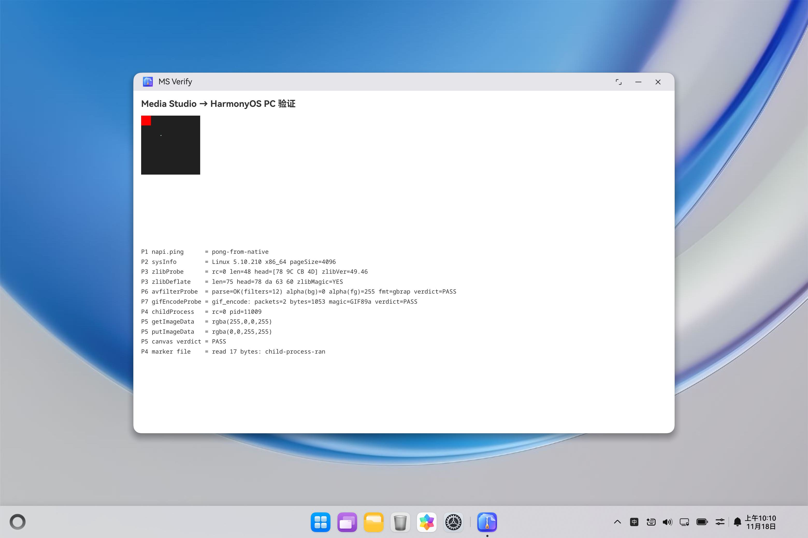

# Media Studio 移植 HarmonyOS PC —— 架构设计方案

> 版本：v1.10（方案验证 + M1 引擎移植 + M2 抠像引擎移植 + M3 应用界面与 C3 裁剪引擎实测 + 双 ABI 构建与真机复跑准备 + C5/C6/C7 三张图片页与设置页移植实测 + C6 背景层改为审核要求的纯色 + 上架隐私合规 + 侧边栏图标化与可收起 + 上架应用名对齐）
> 日期：2026-11-21
> 范围：将 `media-studio`（Electron 桌面应用）移植到 HarmonyOS PC / 2in1 设备
> 状态：**方案已在 HarmonyOS 26.0.0 (API 26) + 2in1 模拟器上完成关键路径验证；M1（C1 视频→GIF）、M2（C2 抠像）、M3（C3 裁剪 + 完整应用界面）三条能力均已跑通端到端；C5 图片裁剪 / C6 图标生成 / C7 图片转黑白 / 设置页四张图片侧页面也已移植完成并在 2in1 上实测；C6 的分层图标背景层已按审核要求改为**纯色**（v1.7）；**上架隐私合规已落地**（v1.8）：首启隐私弹窗（未同意不构建任何功能页）、设置页「数据和隐私」、本地预置 H5 隐私政策、可撤回同意，**权限清单核对为「零权限」**（HAP 内无 `requestPermissions`，系统 `bm dump` 为空）；应用通过系统文件选择器产出的 GIF 与 Windows 版逐像素一致；工程已支持 arm64-v8a + x86_64 双 ABI 一次构建，aarch64 真机复跑只差设备重新连上（R-13）；**上架应用名已统一为「Media Studio」**（v1.10，R-23 收敛到只剩「公网隐私政策 URL」这一件需人工完成的事），详见 §10 验证报告

---

## 0. 结论摘要

**一句话结论：这不是一次 UI 框架替换，而是「把 10 项平台能力在鸿蒙 PC 上重新落地」的重工程；其中 80% 的代码可以复用，80% 的风险集中在 ffmpeg 引擎与进程模型上。**

| 维度 | 结论 |
|---|---|
| **推荐方案** | **方案 A：ArkTS/ArkUI 原生重写 UI + NAPI 原生模块承载 C++ 引擎**（含 ffmpeg） |
| **是否可行** | 完全可行，且**关键路径已本机实测通过**（§10）：NAPI 桥接、原生子进程、Canvas 像素读写、musl zlib、ffmpeg OHOS 交叉编译 |
| **不可行点** | 仅「像 Electron 那样 spawn 一个独立 ffmpeg 可执行文件」这一条路走不通（鸿蒙无任意可执行文件执行权限）——但**等价的子进程模型已被实测证明可行** |
| **核心工作量** | 引擎移植 ≈ 12–18 人日；UI 重写 ≈ 15–20 人日；系统接线与上架 ≈ 8–13 人日。合计 **35–50 人日**（单人） |
| **最大风险** | ① 引擎内核改造（spawn → 进程内 libav*） ② WYSIWYG 预览的帧来源 ③ libx264→libopenh264 的行为变更 |
| **可直接复用的资产** | `sdk/` 的 C++ 滤镜逻辑（1229 行）几乎原样保留；`mono1bpp.ts` / `pngrgb.ts` / `cropMath.ts`（443 行）几乎逐行翻译为 ArkTS；本机已有跑通的鸿蒙 NAPI 原生模块模板（见 `jieya-harmony`） |

### 0.1 v1.1 实测验证结论速览

| # | 待验证项 | v1.0 状态 | **v1.1 实测结论** |
|---|---|---|---|
| V1 | ArkUI Canvas 像素读写 | 待验证 | ✅ **通过**：`getImageData`/`putImageData` 读写像素完全正确（`rgba(255,0,0,255)` / `rgba(0,0,255,255)`） |
| V3 | 原生子进程可用性 | 存疑 | ✅ **通过**：`OH_Ability_StartNativeChildProcess` 在 2in1 上对三方应用返回 `rc=0`，子进程真实执行 |
| V4 | PNG 所需 zlib 流 | 待验证 | ⚠️ **结论修正**：`@ohos.zlib` **没有**裸 buffer 接口；原生 `libz` 输出 `78 9C`（zlib/RFC1950）→ **PNG 编码必须下沉到原生层** |
| V5 | picker PC 端 API | 待验证 | ✅ **通过**：`DocumentViewPicker` + `fileSuffixFilters` + `maxSelectNumber` 存在（API 10+/12+） |
| V7 | 包体上限 | 待验证 | 🟡 **部分闭环**：含 ffmpeg 的 HAP 实测 **19.08 MiB**（20,008,188 字节），体积无压力 |
| V8 | ffmpeg 交叉编译 | 风险 R-01 | ✅ **通过**：x86_64 与 aarch64 **双架构**构建成功，LGPL 许可，所需滤镜集全部启用 |
| **V11** | **滤镜字符串能否原样执行** | 未知 | ✅ **通过**：`mask_builder.cpp` 的完整 `filter_complex` 在设备上解析出 **12 个滤镜**，alpha 表达式求值正确（背景→0，前景→255） |
| **V12** | **设备端能否真实编码 GIF** | 未知 | ✅ **通过**：设备上实际编码出 2 帧动画 GIF，`GIF89a` 头，1053 字节 |
| V2/V6/V9/V10 | 预览/拖拽/定位/CPU 配额 | 待验证 | 仍未验证（需交互或文档核对），保持开放 |

> **最重要的一条**：V11 + V12 合起来证明 —— **引擎改造只需替换「执行器」，滤镜逻辑与流水线可以原样迁移**。这是整个方案最大的工作量假设，现已被实测证伪为「成立」。

### 0.2 v1.2 M1 引擎移植实测结论速览

M1 = 把 Windows 版的「spawn ffmpeg.exe」替换为「进程内 libav*」，并让 **C1 视频→GIF 整条流水线**在设备上产出与 Windows 版一致的结果。

| # | 验证项 | v1.1 状态 | **v1.2 实测结论** |
|---|---|---|---|
| M1-a | 进程内执行器 | 未实现 | ✅ **通过**：`sdk/src/engine/ms_inproc_exec.cpp` 复刻 CLI 的自动旋转、输入绑定、格式协商三条隐式行为 |
| M1-b | C1 流水线端到端 | 未实现 | ✅ **通过**：设备上产出 GIF，容器统计与 Windows 黄金件**逐字段一致**（480×360 / 24 帧 / r_frame_rate 12/1 / duration 2.0） |
| M1-c | **像素级对拍** | — | ✅ **通过**：解码为 rawvideo rgb24 后**逐字节比对，0 差异**（12,441,600 字节；中间 mkv 6,220,800 字节亦 0 差异） |
| M1-d | **R-03 自动旋转** | ⬜ 最高风险 | ✅ **已解除**：竖拍样例（90° display matrix）在设备上输出 **480×640**（而非 480×360），与宿主 CLI 黄金件**像素 0 差异**（22,118,400 字节） |
| M1-e | GIF 帧数统计 | `frames=0` | ✅ **已修复**：根因是 OHOS 精简构建漏配 `--enable-parser=gif`（见 §10.5 #12），现为 `frames=24 fps=12` |
| M1-f | aarch64 真机 | 未上真机 | ⬜ 仍开放（R-13），上架前必做 |

> **M1-c + M1-d 合起来的意义**：本移植最大的工作量假设（"引擎只需换执行器"）与最大的静默错误风险（自动旋转）**同时被证伪为"成立"**。至此，C1 功能在鸿蒙侧已达到「与 Windows 版可替换」的水准。

### 0.3 v1.3 M2 抠像引擎移植实测结论速览

M2 = 把 **C2 抠像（gif_keying）** 流水线也搬进进程内引擎：复用与 Windows 版**字节相同**的 `mask_builder.cpp` 滤镜串，走「掩膜链→ffv1 中间件 → palettegen 调色板 → paletteuse 出 GIF」三段。

| # | 验证项 | v1.2 状态 | **v1.3 实测结论** |
|---|---|---|---|
| M2-a | C2 流水线端到端 | 未实现 | ✅ **通过**：设备产出 GIF（`rc=0 inFrames=24 frames=60 size=160x120`），容器统计与 Windows 黄金件**逐字段一致**（160×120 / 60 帧 / `r_frame_rate=15/1` / `avg_frame_rate=50/3` / `duration=4.000000`） |
| M2-b | **像素级对拍** | — | ✅ **通过**：解码为 rawvideo rgba 后**逐字节比对，0 差异**（4,608,000 字节，含 alpha 通道） |
| M2-c | **帧节奏对拍** | — | ✅ **通过**：逐帧 `pts_time`/`duration_time` 完全一致（0.07/0.06 交替，各 40/20 帧） |
| M2-d | **输出时基决策** | 主机侧用主输入 fps 兜底 | ✅ **已修正**：改为复刻 CLI 的 `choose_out_timebase()`（见 §10.5 #15、§10.9） |
| M2-e | 滤镜串一致性 | — | ✅ **通过**：设备端 `keying: filter = ...` 与宿主 CLI 用的串**逐字节一致**（含水印条件 `gt(X,132)*gt(Y,90)+lt(X,32)*lt(Y,18)`） |
| M2-f | aarch64 真机 | 未上真机 | ⬜ 仍开放（R-13），上架前必做 |

> **M2 的真正收获不是"抠像能跑"，而是暴露了一个此前从未被触发的引擎级缺陷**：输出时基的兜底策略。它在 C1 上恰好给出正确结果（因为 C1 的图输出帧率已知），在 C2 上则会把 15 fps 的时间戳压进 1/12 时基，**产生重复 DTS 并让 matroska 封装直接报错**。详见 §10.9。

### 0.4 v1.4 M3 应用界面与 C3 裁剪引擎实测结论速览

M3 = 把 `harmony-app/` 从「只有一页探针」变成**真正的应用**（首页 + 视频转GIF + GIF抠图 + 视频裁剪 + 自检），并补上 C3 裁剪引擎。

| # | 验证项 | v1.3 状态 | **v1.4 实测结论** |
|---|---|---|---|
| M3-a | 应用外壳与四个页面 | 只有探针页 | ✅ **通过**：左侧导航 + 右侧内容区，首页/视频转GIF/GIF抠图/视频裁剪/自检五页在 2in1 上全部正常渲染与交互 |
| M3-b | **生产 NAPI 接口**（异步 + 进度回调） | 不存在 | ✅ **通过**：`media_api.cpp` 用 `napi_async_work` + 线程安全函数实现 5 个接口，返回 Promise，进度回调真实触发 |
| M3-c | **C3 裁剪引擎** | 未实现 | ✅ **通过**：新增 `sdk/src/engine/ms_crop.{h,cpp}`，滤镜链是 Windows `buildFilterChain()` 的逐行移植；设备产出 320×240 / 12 帧 |
| M3-d | **WYSIWYG 预览帧来源** | 未解决 | ✅ **通过**：新增 `decodeFirstFrame()`（`trim=end_frame=1` + PNG 编码器），裁剪页预览正常显示首帧并支持拖拽/缩放 |
| M3-e | **系统文件选择器**（V5） | 仅 API 存在 | ✅ **通过**：`DocumentViewPicker` 在 2in1 上正常拉起，`fileSuffixFilters` 生效（只列 .mp4），选中的文件被拷进沙箱后正常处理 |
| M3-f | **界面产物的像素一致性** | — | ✅ **通过**：在应用里经「选文件 → 开始抠图」产出的 GIF，与 Windows 黄金件 **rgb24 3,456,000 字节 0 差异** |
| M3-g | **C3 输出容器** | — | 🟡 **部分闭环**：OHOS 精简构建**没有 H.264 编码器**（libx264 是 GPL、libopenh264 未集成），当前交付 **MJPEG + AVI**，与 Windows 的 MP4/H.264 不同（新增 R-17） |
| M3-h | 滤镜图提前结束时被误判为失败 | 未暴露 | ✅ **已修复**（新增 R-18）：`trim` 等滤镜到窗口末尾后拒绝再收帧，`av_buffersrc_add_frame_flags()` 返回 `AVERROR_EOF` 被当成硬错误 |

> **M3 暴露的第二个引擎级缺陷（R-18）同样是"沉默"的**：执行器把滤镜图正常的结束信号当成了失败，首帧解码因此报 `End of file`。这类缺陷只有在**引擎开始复用既有滤镜**（C1/C2 自己不裁窗口）时才会显形 —— 与 R-16 同属「里程碑推进才会暴露」的一类。

### 0.5 v1.5 双 ABI 构建与 aarch64 真机复跑（进行中）

v1.5 只做一件事：**把 R-13「未在 aarch64 真机上实跑」闭合掉**。为此先把工程从「只编 x86_64」改成「一次构建产出 arm64-v8a + x86_64 双 ABI」，再把真机复跑固化成一条可重复执行的命令。

| # | 验证项 | v1.4 状态 | **v1.5 实测结论** |
|---|---|---|---|
| M4-a | **双 ABI 一次构建** | 只编 x86_64 | ✅ **通过**：`abiFilters` 改为 `["arm64-v8a","x86_64"]`，同一个 HAP 内含 `libs/arm64-v8a/` 与 `libs/x86_64/` 两套 ffmpeg 库 |
| M4-b | **按 ABI 隔离的 ffmpeg 头文件** | 全工程共用一份 `config.h`（x86_64 版） | ✅ **已解决**（新增 R-19）：`config.h` / `libavutil/avconfig.h` 按 ABI 放进 `include/<abi>/` 覆盖层，CMake 用 `${OHOS_ARCH}` 选路径，覆盖层缺失直接 `FATAL_ERROR` |
| M4-c | **x86_64 回归**（证明改造没破坏已验证路径） | — | ✅ **通过**：P1–P15 全绿，`out.gif` 483,220 B / `out_rot90.gif` 694,719 B / `out_key.gif` 12,069 B 与 v1.2/v1.3 基线**逐字节一致**；与 Windows 黄金件 **rgb24 3,456,000 与 22,118,400 字节 0 差异** |
| M4-d | **真机复跑脚本** | 无 | ✅ **新增**：`tools/run-ohos-device-check.sh` 一条命令完成「装包 → 拉起 → 点开自检 → 收探针日志 → 拉产物 → 与 Windows 黄金件对拍」，已在 2in1 模拟器上端到端实测 |
| M4-e | **aarch64 真机实跑** | ⬜ 开放（R-13） | 🟡 **构建侧已就绪，待设备**：双 ABI HAP 已产出、arm64 库 ELF 校验为 `0xB7`（AArch64）、复跑脚本已验证；本轮收尾时真机（MatePad Mini）已从 USB 总线离线，需重新插线后执行那条命令 |

### 0.6 v1.6 图片侧四页移植实测（C5 / C6 / C7 + 设置页）

v1.6 把 **C5 图片裁剪、C6 图标生成、C7 图片转黑白** 与设置页搬进鸿蒙侧，并定下三张图片页的共同技术路线：**全部在 ArkTS 层实现，零新增 C++**。

| # | 验证项 | v1.5 状态 | **v1.6 实测结论** |
|---|---|---|---|
| M5-a | **承载路线重选** | 计划用 ArkUI Canvas 2D | ✅ **路线改写（新增 R-20）**：ImageKit（`@kit.ImageKit`）负责解码与缩放，像素运算放 ArkTS，PNG 编码复用原生 `zlibDeflate`。**不依赖 Canvas**，理由见 §10.12.1 |
| M5-b | **C7 图片转黑白** | 未实现 | ✅ **通过**：`mono1bpp.ts` 逐行移植为 `Mono1bpp.ets`；设备产出 `media_studio_mono.bmp` **15,662 B**（= 62 + 52×300，与 400×300 的 1-bit BMP 理论值精确吻合） |
| M5-c | **C6 图标生成** | 未实现 | ✅ **通过**：Android **20 个文件**（17 PNG + 3 配置）、iOS **15 个**（13 PNG + 2 配置）、HarmonyOS **6 个**（4 PNG + 2 配置）全部产出；PNG 头逐个核验尺寸/色型，**扁平图一律 RGB（无 alpha）**、透明图一律 RGBA |
| M5-d | **C6 cover/safe 几何** | 未实现 | ✅ **通过**：前景层内容**全部落在画布中央 2/3 安全区内**（越界像素 0）；背景层与主机 ffmpeg 参考图**平均绝对差 1.92**（同一几何、不同重采样核） |
| M5-e | **C5 图片裁剪** | 未实现 | ✅ **通过**：默认画布（400×300 贴合原图）裁剪结果与原图**解码后逐字节 0 差异**；放大 125% 后与 ffmpeg 参考图**平均绝对差 2.33** |
| M5-f | **C5 输出格式** | 只有 PNG | ✅ **通过**：PNG（自研编码器）、JPG（`image/jpeg`）、WebP（`image/webp`）三档实测均产出 400×300 正确尺寸（新增 R-21：JPG 必须先压平，ImageKit 的 JPEG 打包器会把透明像素变黑） |
| M5-g | **C5 交互** | — | ✅ **通过**：拖拽平移、双指缩放（锚点保持）、⊕/⊖/适应 三种缩放入口、三分线 + 遮罩 + 蓝色裁剪框的 WYSIWYG 预览全部正常 |
| M5-h | **ImageKit 缩放语义** | — | ⚠️ **已澄清（新增 R-22）**：`desiredSize` 是**强制拉伸到目标尺寸、不保比例**；`cover`/`safe` 必须自己算目标尺寸，否则图标会被拉变形 |

> **v1.6 的真正收获不在"又多了三页"**，而在于**一次把三张图片页的承载路线钉死了**：ArkUI Canvas 2D 在 PC 端并不可靠，而「ImageKit 解码 + ArkTS 像素运算 + 原生 zlib 编码」这条链路已经在 Mono / Icons / Crop 三张页上各跑通一次，且**三张页共用同一组基础设施**（`ImageIo.ets` / `Png.ets`）。后续再有图片类页面，**零新增底层代码**。

### 0.7 v1.7 C6 背景层改为审核要求的纯色

v1.6 的 C6 是**按 Windows 的行为**保真移植的，于是分层图标的「背景层」里装的是**图像压平**的结果（Windows 的 `renderJob()` 先填底色再把源图 cover 进去）。这与「分层图标背景层 = 纯色、不透明、无透明像素」的审核语义不符，也拿不回「纯色背景色」这个设置项的意义。经确认后改为**纯色**。

| # | 验证项 | v1.6 状态 | **v1.7 实测结论** |
|---|---|---|---|
| M6-a | **背景层改成纯色** | 图像压平（与 Windows 一致） | ✅ **通过**：给 `IconJob.fit` 增加 **`solid`** 模式 —— `HarmonyOS/media/background.png` 与 Android 的五个 `ic_launcher_background.png` 改为**只填背景色、不含图像** |
| M6-b | **纯色层确实是纯色** | — | ✅ **通过**：1024×1024 全部 1,048,576 个像素**颜色完全一致**、非不透明像素 = 0 |
| M6-c | **纯色用的是用户选的颜色** | — | ✅ **通过**：把背景色改成 `#336699` 重新生成 → 产出层 **rgb(51,102,153)**、越色像素 0；预览圆圈同步变色 |
| M6-d | **商店图标不受影响** | — | ✅ **通过**：`agc-store-1024.png` / `iOS/icon-1024.png` 仍是 cover 适配的图像，与 ffmpeg 参考图平均绝对差 **1.92**（几何未变） |

> **这是本移植中第一处「两端故意不一致」**：鸿蒙侧的背景层是纯色，Windows 侧仍是图像压平。理由是**审核语义**（鸿蒙侧要求纯色）优先于**两端逐字节一致**，且 Windows 侧本轮不动（见 §10.12.5 第 2 条）。

### 0.8 v1.8 上架隐私合规（首启弹窗 + 数据和隐私 + 本地 H5 隐私政策）

v1.7 对齐的是**素材**的审核语义，v1.8 处理的是**应用本体**的合规面：应用市场上架要求「首次使用必须弹出隐私声明、未同意不得使用」，隐私政策必须是**独立文本**（不能藏在用户协议里），应用内要有**可查看入口**，且「申请的权限」与「实际使用」必须一致。

| # | 验证项 | v1.7 状态 | **v1.8 实测结论** |
|---|---|---|---|
| P1 | **首启弹隐私弹窗** | 无 | ✅ **通过**：首次启动弹出「隐私政策」卡片（半透明遮罩 + 四条摘要 + 「《隐私政策》全文」链接 + **「不同意并退出」** / **「同意并继续」**）。**无勾选框、无默认勾选**，两个按钮都必须用户主动点 |
| P2 | **未同意不得使用** | 功能页可直接进入 | ✅ **通过**：同意状态不是「granted」时**根本不构建任何功能页**（ArkUI 的 `if` 分支为假时组件不会被构造），页面上只有那张遮罩卡片 |
| P3 | **同意状态落盘** | — | ✅ **通过**：`preferences` 落盘「同意 + 政策版本号」。实测：同意后 `aa force-stop` 再启动，**不再弹窗**；版本号与当前版本不一致即视为未同意（政策改版会自动重新征求） |
| P4 | **必须有拒绝路径** | — | ✅ **通过**：「不同意并退出」→ 页面锁死为「未同意隐私政策」状态（只剩「退出应用」）→ `terminateSelf()` 退出；再次启动**仍弹窗** |
| P5 | **设置页「数据和隐私」** | 纯静态「关于」页 | ✅ **通过**：「设置 → 数据和隐私」卡片 —— 三条合规摘要 + **当前同意状态**（已同意 / 未同意 / 政策版本号）+ 「查看隐私政策」按钮 |
| P6 | **本地预置的 H5 隐私政策** | 无 | ✅ **通过**：`entry/src/main/resources/rawfile/privacy.html`（9,373 B，**单文件、零外部依赖、无脚本**），由 ArkWeb 以 `resource://rawfile/privacy.html` 加载。实测 hilog：`[WebNavigation] OnPageEnd httpStatusCode:200`、`net_error=0` |
| P7 | **可撤回同意** | — | ✅ **通过**：隐私政策页底部「撤回隐私同意」→ 删记录 → `router.back()` → 首页 `onPageShow` 重读状态 → **首启弹窗重新出现**，必须重新同意才能继续用 |
| P8 | **权限清单核对** | `module.json5` 无 `requestPermissions` | ✅ **通过（保持零权限）**：HAP 内 `module.json` **无 `requestPermissions` 字段**；系统侧 `bm dump` 为 `reqPermissions: []` / `reqPermissionStates: []` / `permissions: []` / `defPermissions: []` |

> **零权限是本应用最强的合规论据**：审核最容易踩的「过度申请」和「权限用途含糊」两类驳回点，本应用**一个都不会触发** —— 因为它一个权限都不申请。代价是必须把这一点在隐私政策里**写清楚**（否则审核会认为「没写权限 = 漏写」），所以 `privacy.html` 第三节用表格逐项列出「不申请 + 原因」。
>
> **本地 H5 不能替代公网地址**：AGC 后台要填的隐私政策 URL 必须是**公网可访问的 HTTPS 地址**，应用内的 `resource://rawfile` 副本只是应用内兜底。同一份 `privacy.html` 是零依赖单文件，可原样部署到任意静态托管（见 §10.13.4）。

### 0.9 v1.9 侧边栏图标化 + 可收起

v1.8 解决的是「能不能过审」，v1.9 解决的是「像不像一个正经的 PC 应用」。原先左侧导航是**纯文字列表**（首页 / 视频转GIF / GIF抠图 / …），和剪映、美图秀秀那类工具的**图标栏**差得很远；而且侧边栏固定 190vp 宽，短屏/小窗下白白占掉一截。

| # | 验证项 | v1.8 状态 | **v1.9 实测结论** |
|---|---|---|---|
| N1 | **每个功能配图标** | 无图标，纯文字 | ✅ **通过**：新增 9 个自绘 SVG（`resources/base/media/nav_*.svg`）+ 1 个汉堡键，24×24 线性风格、白色描边；实测全部正常渲染 |
| N2 | **侧边栏可收起** | 固定 190vp | ✅ **通过**：`navCollapsed` 状态驱动，收起 58vp / 展开 190vp；顶部汉堡键一键切换，默认**收起**（对齐剪映/美图的图标栏） |
| N3 | **收起后仍能认出功能** | — | ✅ **通过**：收起时只留图标，**悬停弹出名称气泡**（画在根 Stack 最外层，不被内容区遮挡） |
| N4 | **展开态仍保留文字** | 纯文字 | ✅ **通过**：展开时「图标 + 名称」，当前项额外显示一行灰色说明；当前项用蓝色圆角底 + 满不透明度图标 |
| N5 | **点击图标能切页** | — | ✅ **通过**：收起态点「设置」齿轮 → 直接进入设置页，当前项高亮同步迁移 |

> **为什么自绘 SVG 而不用 HarmonyOS Symbol**：`$r('sys.symbol.*')` 依赖 HarmonyOS SDK 随附的符号清单，本机 `command-line-tools/sdk` 与 DevEco Studio 安装里都**搜不到**任何 `sys.symbol.` 资源定义（API 12 的 OpenHarmony SDK 不带这套清单）。与其猜符号名，不如自绘 —— 完全可控、不依赖 SDK 版本、20px 下也清晰。
>
> **唯一有版式耦合的地方**：收起态的气泡是**绝对定位**的，靠 `Index.ets` 顶部的三个常量（`NAV_TOP` / `NAV_ROW_H` / `NAV_ROW_GAP`）算位置。改了侧边栏的 padding 或行高，**必须同步改这三个常量**（注释里已写明）。

---

## 1. 现状盘点（代码级）

### 1.1 现有分层

```
electron-app/
├── src/main/          Electron 主进程（TypeScript，~900 行）
│   ├── main.ts          窗口、IPC 处理器、SDK worker 子进程管理
│   ├── videoCrop.ts     ffmpeg 滤镜链生成 + 进度解析
│   └── logger.ts        日志（%TEMP%\media-studio.log）
├── src/preload/       contextBridge 暴露 window.electronAPI（14 个方法）
├── src/renderer/      React + Vite 渲染层（4132 行，含 CSS 692）
│   ├── pages/           Converter / Crop / Icons / Keying / Mono / VideoCrop / Settings
│   └── lib/             cropMath / mono1bpp / pngrgb / appicons / mediaStudio
└── resources/sdk/     ffmpeg.exe(145MB) + ffprobe.exe(145MB) + libmedia_studio.dll + ms_demo.exe

sdk/                  独立 C++ SDK（1229 行），C ABI（media_studio.h）
├── src/ffmpeg/         executor.cpp —— 以子进程方式调用 ffmpeg/ffprobe
├── src/gif_keying/     mask_builder.cpp —— 生成 geq/alphamerge 滤镜表达式
└── src/video_to_gif/   video_to_gif.cpp —— 三段式 GIF 编码流水线
```

### 1.2 能力清单：10 项能力及其归属

把每个页面拆到「能力」粒度，是判断复用度的基础。

| # | 能力 | 现状实现 | 依赖 | 移植难度 |
|---|---|---|---|---|
| C1 | 视频 → 透明 GIF | `sdk/src/video_to_gif/` + ffmpeg | ffmpeg（palettegen/paletteuse/ffv1/split/trim/reverse/concat） | 中（引擎改造） |
| C2 | GIF 抠像/去水印 | `sdk/src/gif_keying/mask_builder.cpp` + ffmpeg | ffmpeg（geq/alphaextract/alphamerge） | 中（引擎改造） |
| C3 | 视频裁剪重编码 | `main/videoCrop.ts` | ffmpeg（crop/scale/pad）+ libx264 | 中（引擎改造 + 编码器换人） |
| C4 | 视频探针 | `main.ts` `sdk:probe` | ffprobe（JSON 输出） | 低（并入引擎，约 120 行） |
| C5 | 图像交互裁剪 | `pages/Crop.tsx` + `lib/cropMath.ts` | 浏览器 Canvas 2D | 中（换 ArkUI Canvas） |
| C6 | 移动端图标批量生成 | `pages/Icons.tsx` + `lib/appicons.ts` | Canvas 2D + 自研 PNG 编码器 | 中（换 ArkUI Canvas + PixelMap） |
| C7 | 1-bit 单色化 / BMP / C 数组 | `lib/mono1bpp.ts`（206 行） | **无**（纯函数） | **低（逐行翻译）** |
| C8 | PNG 无 alpha 编码器 | `lib/pngrgb.ts`（84 行） | `CompressionStream('deflate')` | 低（换 @ohos.zlib） |
| C9 | 文件选择 / 保存 / 定位 | `dialog:*` / `shell:reveal` / `fs:*` IPC | Electron dialog & fs | 低（换 picker / fileIo） |
| C10 | 拖拽导入 + 进度 + 取消 | `components/Dropzone.tsx` + `progress:*`/`done:*` IPC | Electron DnD | 中（换 ArkUI 拖拽框架） |

**结论：**
- **纯搬运（几乎零改动）**：C7、C8、C4，以及 C5/C6 中的几何与规格表（`cropMath.ts` 153 行、`appicons.ts` 262 行）。
- **必须重写载体、保留算法**：C1、C2、C3 的滤镜表达式（`mask_builder.cpp` 生成的 `if(...)`/`geq` 字符串、`video_crop.ts` 的 crop→scale→pad 三段链）——**这是本方案保真度的核心资产，不应改写成 API 调用**。
- **必须换平台实现**：C5、C6、C9、C10。

> **v1.6 修订**：C5 / C6 / C7 三张图片页的「换 ArkUI Canvas」结论已被实测推翻，改走 **ImageKit + ArkTS 像素运算 + 原生 zlib**（R-20，见 §10.12.1）。C5/C6 的**算法部分（几何、规格表、缩放适配）仍是纯搬运**，换掉的只是像素搬运与编码的载体。

### 1.3 现状的三个硬约束（移植时必须正面处理）

**① 引擎通过 spawn 外部可执行文件驱动**

`sdk/src/ffmpeg/executor.cpp` 在 Windows 下用 `CreateProcessW` 拉起 `ffmpeg.exe`，把参数数组拼成命令行；`main/videoCrop.ts` 同理。鸿蒙没有这条路径（见 §2.3 红线 R1）。

**② 渲染层深度依赖 DOM Canvas**

`Crop.tsx` / `Icons.tsx` / `Mono.tsx` / `VideoCrop.tsx` 共 65 处 Canvas 2D 调用（`getContext('2d')`、`toBlob`、`createImageBitmap`）。ArkUI 没有 DOM Canvas，需要映射到 ArkUI `Canvas` 组件 + `PixelMap`。

**③ 体积与许可**

`resources/sdk/` 下两个静态 GPL 构建共 **291 MB**（实测 `ffmpeg.exe` 145 MB，配置含 `--enable-gpl --enable-libx264 --enable-libx265`）。鸿蒙版需重新裁剪构建并明确许可策略（见 §5.3）。

---

## 2. 目标平台约束（HarmonyOS PC / 2in1）

### 2.1 运行模型差异

| 维度 | Electron（现状） | HarmonyOS PC（目标） |
|---|---|---|
| 运行时 | Chromium + Node.js | ArkTS/ArkUI 运行时 + ArkTS-Native，无 Node、无 Chromium |
| 进程 | 任意 spawn 外部 exe | **不能**执行任意可执行文件；只能加载 `.so` |
| UI | DOM + CSS | 声明式 ArkUI 组件树 |
| 2D 绘制 | DOM `<canvas>` | ArkUI `Canvas` 组件 + `PixelMap` |
| 文件访问 | Node `fs` 全权限 | 沙箱 + `picker` 授权（URI 授权模式） |
| 打包 | NSIS / zip | HAP（.hap），签名后分发 |
| 窗口 | `BrowserWindow` | `@ohos.window`（最大化/最小化/置顶/自定义标题栏） |

### 2.2 能力对照表（Electron API → HarmonyOS API）

| Electron 用法 | 位置 | HarmonyOS 对应 | 备注 |
|---|---|---|---|
| `BrowserWindow` | main.ts:634 | `Window` / `windowStage.loadContent` | PC 端支持最大化、置顶、自定义标题栏（API 20+ 有窗口增强） |
| `ipcMain.handle` | main.ts:263+ | NAPI 模块（`napi_create_function` + `napi_async_work`） | 已验证可用，见 §4.3 |
| `ipcRenderer.invoke` | preload.ts | NAPI 直接调用（ArkTS 侧是普通函数调用） | 无需桥接层 |
| `contextBridge.exposeInMainWorld` | preload.ts | `types/libmedia_studio/index.d.ts` 声明 + 直接 import | 已验证可用 |
| `event.sender.send(progress)` | main.ts:496 | `napi_threadsafe_function` 回抛 JS 线程 | jieya-harmony 已有成熟实现 |
| `dialog.showOpenDialog` | main.ts:311 | `picker.DocumentViewPicker` | 需处理 URI → fd 授权 |
| `dialog.showSaveDialog` | main.ts:320 | `picker.DocumentSavePicker` | 同上 |
| `shell.showItemInFolder` | main.ts:328 | `fileIo` + `Want`（拉起文件管理器定位） | 需实测 PC 行为（见 V9） |
| `fs.readFileSync` / `writeFileSync` | main.ts:333/345 | `fileIo.openSync/readSync/writeSync` 或引擎内直读 | 引擎内直读更优（免 URI 转换） |
| `child_process.spawn` | main.ts:180/400 | **不可用**（红线 R1） | 改为进程内执行器或 NativeChildProcess |
| `<canvas>` 2D | Crop/Icons/Mono/VideoCrop | ArkUI `Canvas` + `CanvasRenderingContext2D` | 需验证像素级读写 API（V1） |
| `canvas.toBlob('image/png')` | Icons.tsx:147 | `image.createImagePacker().packing(pixelMap,'image/png')` | |
| `createImageBitmap(Blob)` | Crop/Icons/Mono | `image.createImageSource(buf).createPixelMap()` | |
| `CompressionStream('deflate')` | pngrgb.ts | `@ohos.zlib` | 需确认 zlib(RFC1950) 模式（V4） |
| `<video>` 预览帧 | VideoCrop.tsx | **不能直接绘制**（红线 R3） | 改由引擎解码单帧 |
| HTML5 拖拽 | Dropzone.tsx | ArkUI `onDragStart` / `onDrop` + `drag` 框架 | 需验证 PC 外部拖入（V6） |
| `%TEMP%\*.log` | logger.ts | `hilog` + 应用沙箱 `filesDir` | |

### 2.3 三条红线

**R1 —— 不能 spawn 独立可执行文件。**
逐一排除：

| 手段 | 结论 | 依据 |
|---|---|---|
| `@ohos.process.runCmd` | ❌ 不可用 | `@systemapi` + 仅系统应用；需 Full SDK 且需关闭 SELinux |
| `childProcessManager.startArkChildProcess` | ❌ 不匹配 | 只能启动 **ArkTS 入口**（`.ets`），无法承载 C++ 引擎 |
| `OH_Ability_StartNativeChildProcess` | ✅ **可用（已实测）** | API 13+，**仅 2in1 / 平板**；加载 `.so` 并调导出入口 + fd 管道 + IPC。**本机 2in1 模拟器实测 `rc=0`，子进程真实执行**（§10.3） |
| 进程内执行器（NAPI `napi_async_work`） | ✅ **可用（已实测）** | 无设备形态限制，与 jieya-harmony 成熟模式一致；本机实测 ArkTS↔C++ 调用正常 |

> **重要修正（v1.1 实测）**：v1.0 曾把 `OH_Ability_StartNativeChildProcess` 列为「仅 2in1/平板、可能不可用」的备选。实测证明它在 **2in1 上对三方应用完全可用**——这意味着 Electron 版「spawn 一个 worker 进程 + JSON-lines 协议」的架构可以 **1:1 迁移**，不必退化为进程内执行。详见 §4.2 与 §10.3。

**R2 —— 没有 GIF 编码器。**
鸿蒙媒体框架（AVPlayer / AVCodec / AVTranscoder）**不提供 GIF 编码**，也无法表达 `geq` → `alphaextract` → `alphamerge` → `palettegen`/`paletteuse` 这类像素级滤镜图。C1/C2/C3 **必须自带 ffmpeg**。（OpenHarmony 官方 third_party_ffmpeg 已有 OHOS 适配，构建目标为 `libohosffmpeg.so`。）

**R3 —— ArkUI `Video` 组件不能作为 Canvas 绘制源。**
`VideoCrop.tsx` 的 WYSIWYG 预览依赖「把 `<video>` 逐帧画进 canvas」。鸿蒙侧 `Video` 是独立渲染组件，无法 `drawImage` 进 Canvas。替代方案见 §5.5。

---

## 3. 方案选型

### 3.1 三个候选方案

**方案 A（推荐）：ArkTS 原生重写 + NAPI C++ 引擎**

ArkUI 重写全部 7 个页面；C++ 引擎（ffmpeg + 现有 SDK 逻辑）编译为 `libmedia_studio.so`，通过 NAPI 暴露给 ArkTS。进程内 `napi_async_work` 执行重活。

- ✅ 体验最接近原生桌面应用；PC 窗口/键鼠/多窗口能力齐备；性能与体积可控
- ✅ 引擎能力 100% 保真（滤镜字符串原样保留）
- ✅ 与现有 `jieya-harmony` 工程模板完全同构（同一套 NAPI 骨架、CMake 组织、`.d.ts` 声明方式）
- ❌ UI 层 4132 行需重写；ArkTS 有严格静态类型约束（无 `any`、无动态属性），移植时需补类型
- ❌ 一次性投入较大

**方案 B：ArkWeb 壳 + 现有 React UI**

把 Vite 产物放入 `rawfile/`，ArkWeb 用「虚拟 HTTPS 域名 + `onInterceptRequest`」方式加载以规避 file 协议跨域；JS Bridge 替换 `window.electronAPI`。

- ✅ 复用 4132 行 React 代码，UI 零重写，最快出可用版本（约 8–12 人日）
- ✅ 适合作为**可行性验证**（先验证 ffmpeg .so 在鸿蒙 PC 上的编译、性能、稳定性）
- ❌ 拖拽、`<video>` 本地源、`<canvas>` 高频交互在 ArkWeb PC 上的行为受限（需实测）
- ❌ 桌面原生感弱（自绘标题栏、右键菜单、快捷键、文件对话框都要自己造）
- ❌ 与系统视觉规范存在割裂，长期维护双份 UI

**方案 C：纯 ArkTS 重写引擎（用系统媒体框架替代 ffmpeg）**

- ❌ **否决**：R2 已排除；且 `geq`/`alphamerge`/`palettegen` 无系统等价物

### 3.2 决策矩阵

| 评估项 | 方案 A | 方案 B | 方案 C |
|---|---|---|---|
| UI 复用度 | 0%（重写） | ~95% | 0% |
| 引擎保真度 | 100% | 100% | 不可行 |
| 桌面体验 | 原生 | 折中 | — |
| 首个可用版本 | ~35–50 人日 | ~8–12 人日 | — |
| 长期维护成本 | 低（单栈） | 高（双栈） | — |
| 上架合规友好度 | 高 | 中 | — |

### 3.3 推荐路线：两阶段，A 为终态

```
阶段 0（2–3 人日）  可行性验证
    └─ 最小鸿蒙工程 + ffmpeg 交叉编译 + NAPI 冒烟（转一个 GIF）
    └─ 产出：ffmpeg OHOS 构建脚本、libmedia_studio.so、NAPI 骨架

阶段 1（8–12 人日） ArkWeb 过渡版（可选）
    └─ 若阶段 0 顺利且需尽早交付，可用 ArkWeb 壳先上功能
    └─ 同时开始阶段 2 的 ArkUI 页面重写

阶段 2（15–20 人日） ArkUI 原生重写
    └─ 7 个页面 + 4 个 lib 模块翻译 + Canvas 交互 + 拖拽

阶段 3（5–8 人日）  引擎收口 + 打磨 + 上架
    └─ 进度/取消、错误提示、体积裁剪、签名、上架材料
```

> 若不想维护两套 UI，**跳过阶段 1**，阶段 0 完成后直接进入阶段 2。

---

## 4. 目标架构

### 4.1 分层图

```
┌───────────────────────────────────────────────────────────────────┐
│  ArkUI 表现层（ArkTS）        harmony-app/entry/src/main/ets/     │
│  ┌──────────┬──────────┬──────────┬──────────┬──────────┐      │
│  │Converter │  Crop    │  Icons   │  Keying  │VideoCrop │      │
│  │          │          │  Mono    │          │  Settings│      │
│  └──────────┴────┬─────┴────┬─────┴──────────┴──────────┘      │
│                  │          │                                     │
│         ┌────────▼──────────▼─────────┐                           │
│         │  common/  共享能力层         │                           │
│         │  ├ FileService  (picker)    │                           │
│         │  ├ ImageCanvas  (ArkUI Canvas 封装)                    │
│         │  ├ ProgressBar / Dropzone   │                           │
│         │  └ Transform (cropMath 移植版)                          │
│         └────────┬────────────────────┘                           │
└──────────────────┼────────────────────────────────────────────────┘
                   │ NAPI 调用（同步接口 + 异步任务 + 进度回调）
┌──────────────────▼────────────────────────────────────────────────┐
│  NAPI 桥接层    harmony-app/entry/src/main/cpp/napi_init.cpp     │
│  ├ ms_probe()              → 引擎                                  │
│  ├ ms_video2gif(opts)      → 引擎（返回 taskId）                   │
│  ├ ms_keying(opts)         → 引擎                                  │
│  ├ ms_videocrop(opts)      → 引擎                                  │
│  ├ ms_cancel(taskId)                                                │
│  └ ms_decodeFrame(path,t)  → 返回 PixelMap（供预览，见 §5.5）     │
│  进度：napi_threadsafe_function → ArkTS 线程                        │
└──────────────────┬────────────────────────────────────────────────┘
┌──────────────────▼────────────────────────────────────────────────┐
│  引擎层（新增，不改 Windows 既有实现）  sdk/src/engine/            │
│  ├ engine_cli_exec.cpp    ★ 进程内 ffmpeg CLI 子集执行器          │
│  │    ├ 解析 argv → libavformat/libavfilter/libavcodec          │
│  │    └ avfilter_graph_parse_ptr() 解析滤镜字符串（保真关键）      │
│  ├ engine_probe.cpp       探针（替代 ffprobe JSON）                │
│  ├ engine_decode_frame.cpp 单帧解码（预览用）                      │
│  └ 复用：gif_keying/ video_to_gif/ 的滤镜表达式生成逻辑            │
└──────────────────┬────────────────────────────────────────────────┘
┌──────────────────▼────────────────────────────────────────────────┐
│  第三方：FFmpeg（OHOS aarch64 构建，LGPL）                         │
│  libavformat / libavcodec / libavfilter / libavutil / libswscale  │
└───────────────────────────────────────────────────────────────────┘
```

### 4.2 进程与线程模型

**v1.1 修订**：实测证明 **两种模式都可行**，因此按「先用最简、预留升级」排定：

```
【一期 · 进程内执行】
ArkUI 主线程  ←→  napi_async_work（线程池）  ←→  ffmpeg（内部再开多线程）
                 进度经 napi_threadsafe_function 回抛

【二期 · 进程隔离（已验证可行，随时可切）】
ArkUI 主线程  ←→  NativeChildProcess_Args/FD  ←→  子进程（加载 libmsworker.so:Main）
                        ↑ 与现状 ms_demo 完全同构：stdin/stdout 走 JSON-lines
```

**选型理由**

| 维度 | 进程内 async_work | NativeChildProcess 子进程 |
|---|---|---|
| 实现复杂度 | 低（jieya-harmony 已有成熟模板） | 中（需实现 fd 管道与 IPC 握手） |
| 崩溃隔离 | ❌ ffmpeg 崩溃会带崩主进程 | ✅ 天然隔离 |
| 取消语义 | ✅ 任务表 + 解码循环检查 | ✅ 杀子进程 |
| 设备限制 | 无 | **仅 2in1 / 平板**（实测 2in1 通过） |
| 与现状架构同构度 | 中 | **高**（协议可原样保留） |
| 多任务并发 | 受线程池与 CPU 配额限制 | 子进程隔离，互不干扰 |

**推荐路径**：
1. 一期用**进程内 `napi_async_work`**——实现最快，jieya-harmony 已验证的模式；崩溃风险靠「ffmpeg 对损坏输入返回错误码而非崩溃」来兜底。
2. `engine_iface.h` 抽象出 `run(args, progress)`，**二期可零成本切到子进程模式**：协议沿用现状 `SdkRequest/SdkResult` 的 JSON-lines，**引擎侧无需改协议**，只换承载方式。

**后台存活约束（必须处理）**：用户切走窗口或锁屏时，鸿蒙会冻结/回收应用进程。长视频转 GIF 必须在「用户离开」场景下继续，需要申请长时任务（`KEEP_BACKGROUND_RUNNING` + `backgroundModes`）。见 §7 风险 R-07。

### 4.3 数据通道与协议

沿用现有 `SdkRequest` / `SdkResult` 的 JSON 语义，但改为 NAPI 强类型接口：

```ts
// types/libmediastudio/index.d.ts
export interface VideoToGifOptions {
  width?: number; height?: number; fps?: number; maxColors?: number;
  quality?: number; pingPong?: boolean; startSeconds?: number; endSeconds?: number;
}
export interface MediaResult {
  code: number; message: string; frameCount: number;
  outputWidth: number; outputHeight: number; fileSize: number;
}
export interface MediaStudio {
  probe(input: string): Promise<ProbeResult>;
  videoToGif(input: string, output: string, opts: VideoToGifOptions,
             onProgress?: (p: number, msg: string) => void): Promise<MediaResult>;
  keying(input: string, output: string, opts: KeyingOptions,
         onProgress?: (p: number, msg: string) => void): Promise<MediaResult>;
  videoCrop(input: string, output: string, opts: VideoCropOptions,
            onProgress?: (p: number, msg: string) => void): Promise<MediaResult>;
  cancel(taskId: number): void;
  decodeFrame(input: string, timeMs: number): Promise<PixelMap>;
}
```

`KeyingOptions` / `VideoCropOptions` 字段与 `electron-app/src/renderer/src/types.ts` 保持一一对应，不做字段裁剪 —— 保证两端行为可对照。

### 4.4 引擎内核移植设计（本次移植的核心）

#### 4.4.1 现状与目标

现状：`executor.cpp` 拼命令行 → `CreateProcessW("ffmpeg.exe", args)` → 读 stdout/stderr 解析进度。
目标：同样的参数数组 → 进程内 libav* 调用。

**关键决策：用 `avfilter_graph_parse_ptr()` 解析滤镜字符串，而不是改写成 avfilter API 调用。**

原因：`mask_builder.cpp` 生成的表达式极为精妙（`if(lt((r(X,Y)-231)^2+...,1500)+gt(r(X,Y),220)+...,0,255)` 形式的多条件 OR），改写为 C API 极易引入语义偏差；而 `avfilter_graph_parse_ptr()` 能直接吃字符串，**滤镜逻辑一行不改**。

> ✅ **实测已证明（§10.3 P6）**：该滤镜串在 2in1 设备上被 `avfilter_graph_parse_ptr` 成功解析出 12 个滤镜，且 alpha 表达式求值结果与设计意图完全一致（背景色 → alpha 0，前景色 → alpha 255）。

**实现时的两个 API 陷阱（实测踩到）**

1. **FFmpeg 7.x 重构了 avfilter API**（与 6.x 不同）：
   ```c
   // FFmpeg 6.x
   avfilter_graph_alloc_filter(&ctx, filt, "name");      // 返回 int
   avfilter_init_dict(ctx, args_str, opts);
   // FFmpeg 7.x  ← 实测
   AVFilterContext *ctx = avfilter_graph_alloc_filter(graph, filt, "name");
   avfilter_init_dict(ctx, &opts);                        // opts 是 AVDictionary**
   ```
   滤镜的 `r/g/b/a` 表达式要通过 `av_dict_set(&opts, "a", expr, 0)` 传入。
2. **`geq` 的输出是 planar `gbrap`，不是 packed `rgba`**：alpha 位于独立平面 `data[3]`。按浏览器的 `data[0][3]` 读法会取到**绿道值**。正确做法是用 `av_pix_fmt_desc_get()` 判断 `AV_PIX_FMT_FLAG_PLANAR` 后再取 alpha 平面。
   > 连带注意：`AVFrame::format` 在 7.x 里是 `int`（支持动态像素格式），传给 `av_pix_fmt_desc_get()` 前需显式转 `enum AVPixelFormat`。

#### 4.4.2 需支持的 CLI 子集（当前代码实际用到的）

| 参数 | 出现位置 | 处理方式 |
|---|---|---|
| `-i <path>` | 全部 | `avformat_open_input` + `avformat_find_stream_info` |
| `-vf <chain>` | video_to_gif / gif_keying 的 palettegen 段 | `avfilter_graph_parse_ptr` 建 `buffer→…→buffer` |
| `-filter_complex <fc>` | gif_keying 主链 / video_to_gif ping-pong 段 | 同上，多输入多输出 |
| `-lavfi <chain>` | paletteuse 段 | 用 `avfilter_graph_alloc` + `buffer` 源模拟 lavfi 输入 |
| `-map 0:v:0` / `-map 0:a:0?` | videoCrop | 显式建立流映射 |
| `-c:v <enc>` | videoCrop（libx264）、paletteuse（gif） | `avcodec_find_encoder_by_name` |
| `-pix_fmt <fmt>` | yuva420p / rgba | `AVFrame::format` |
| `-crf <n>` / `-preset` | videoCrop | 映射到编码器私有选项（**LGPL 下需换成 libopenh264，见 §5.3**） |
| `-ss` / `-to` | video_to_gif 片段截取 | `av_seek_frame` + `AVFormatContext` 时长限制 |
| `-progress pipe:1` | videoCrop 进度 | 改为引擎内回调（按已编码帧数/总帧数） |
| `-y` / `-v <loglevel>` | 全部 | 直接映射 |

预计实现量 **800–1200 行 C++**。

#### 4.4.3 两个必须显式复刻的语义（保真陷阱）

**陷阱 1 —— 输入自动旋转。**
ffmpeg CLI 会把输入的 rotation 元数据（`side_data_list` 中的 display matrix）作为 `transpose` 滤镜**自动注入到用户 `-vf` 之前**。因此 `crop`/`scale` 滤镜看到的是**旋转后的显示帧**。

> 现状 `videoCrop.ts` 已依赖这一语义：渲染进程上报的 `sourceWidth/sourceHeight` 是**浏览器显示尺寸**（rotation-aware），并优先于 ffprobe 的编码尺寸。

→ 进程内执行器**必须显式读取 display matrix 并插入 transpose**，否则竖拍手机视频的裁剪结果会与 Windows 版不一致（旋转 90° 时宽高互换，裁剪框会错位）。这是本次移植最容易出现「看起来能用但结果不同」的坑。

**陷阱 2 —— palettegen/paletteuse 两趟流水线。**
现有实现把调色板落盘为 PNG（`tmp_pal`）再作为第二趟输入。进程内可用 `image2` 封装写 PNG 到沙箱 `filesDir`，第二趟再读入 —— 行为与 Windows 版完全一致，且沙箱可写，无需特殊权限。

#### 4.4.4 新增文件（不改动 Windows 既有实现）

遵循 AGENTS.md 的开闭原则 —— 新增旁路，不原地改写：

```
sdk/src/engine/                ← 全新目录
├── engine_iface.h             抽象接口：run(args, progress) → Result
├── engine_cli_exec.cpp/.h     进程内 CLI 子集执行器（OHOS 用）
├── engine_probe.cpp/.h        探针（替代 ffprobe）
├── engine_decode_frame.cpp/.h 单帧解码（预览用）
└── engine_task.cpp/.h         任务表 + 取消（对齐 jieya-harmony 模式）
```

`sdk/src/ffmpeg/executor.cpp`（Windows spawn 版）**保持不变**，仅在鸿蒙工程中不编译。

### 4.5 ffmpeg 交叉编译方案

**目标产物**：`libav*.so`（动态链接，便于 LGPL 合规的「可替换重链接」要求）或静态链入 `libmedia_studio.so`（需提供源码获取方式）。

#### 4.5.0 已验证的本机工具链（v1.1 实测）

| 组件 | 路径 / 版本 | 说明 |
|---|---|---|
| SDK | `D:\IDEs\command-line-tools\sdk` → **HarmonyOS 26.0.0 (API 26)** | `sdk-pkg.json` 实测 |
| NDK clang | `sdk/default/openharmony/native/llvm/bin/clang.exe` → **clang 15.0.4** | 目标三元组 `aarch64-unknown-linux-ohos` / `x86_64-unknown-linux-ohos` |
| sysroot | `sdk/default/openharmony/native/sysroot` | musl（`-D__MUSL__`），含 `libz.so`、`libchild_process.so`、`libace_napi.z.so` |
| 2in1 模拟器 | 实例名 **MateBook Pro**，`HarmonyOS 7.0.0 (API 26)`，`x86_64`，3120×2080 | hdc 走 `127.0.0.1:5555`（`hdc tconn`） |
| 构建宿主 | **Git Bash**（提供 sh/sed/awk/grep/perl）+ **mingw32-make 4.4.1** | 见下方「构建踩坑」 |
| 打包签名 | 需 **Java**：DevEco 自带 JBR 25（`D:\ProgramFiles\DevEco Studio\jbr`） | 未在 PATH 上会导致 `spawn java ENOENT` |
| 交叉编译封装 | `tools/ohos-cc-<arch>.sh`（新文件） | 见下方 |

> **SDK 版本修正**：v1.0 假设 `5.0.0(12)` / `6.0.0(20)`。本机实际可用的是 **API 26（HarmonyOS 26.0.0）**，2in1 模拟器为 **API 26 的 HarmonyOS 7.0.0**。目标工程的 `compatibleSdkVersion` 应按此调整。

#### 4.5.1 关键 configure 参数（已实测通过）

```bash
./configure \
  --target-os=linux --arch=<aarch64|x86_64> \
  --cross-prefix=<arch>-linux-ohos- --enable-cross-compile \
  --cc=<arch>-linux-ohos-clang --cxx=<arch>-linux-ohos-clang++ \
  --ar=<arch>-linux-ohos-ar --nm=<arch>-linux-ohos-nm \
  --ranlib=<arch>-linux-ohos-ranlib --strip=<arch>-linux-ohos-strip \
  --extra-cflags="-D__MUSL__ -fPIC" --extra-ldflags="-fuse-ld=lld" \
  --enable-shared --disable-static \
  --disable-programs --disable-doc --disable-debug \
  --disable-gpl --disable-nonfree --enable-version3 \
  --disable-network --disable-avdevice \
  --disable-vulkan --disable-libdrm --disable-vaapi --disable-vdpau \
  --disable-sdl2 --disable-xlib --disable-libxcb --disable-iconv \
  --disable-everything \
  --enable-protocol=file \
  --enable-demuxer=mov,matroska,webm,avi,image2,gif,flv,mpegts,rawvideo \
  --enable-muxer=mov,matroska,webm,avi,image2,gif,null,rawvideo \
  --enable-decoder=h264,hevc,vp8,vp9,av1,mjpeg,png,gif,rawvideo,ffv1 \
  --enable-parser=h264,hevc,vp8,vp9,av1,mjpeg,png,gif \
  --enable-encoder=gif,ffv1,png,mjpeg,rawvideo \
  --enable-bsf=h264_mp4toannexb \
  --enable-swscale --enable-avfilter \
  --enable-filter=fps,scale,format,split,trim,setpts,reverse,concat,\
geq,alphaextract,alphamerge,palettegen,paletteuse,crop,pad,color,overlay,rotate,transpose,hflip,vflip,copy,null
```

> **v1.2 补充**：三个组件是后来才补上的，漏配任何一个都会**静默**出问题 ——
> `--enable-decoder=ffv1`（中间文件是 ffv1，必须能回读）、`--enable-parser=gif`（否则 GIF 帧数统计为 0，见 §10.5 #12）、`--enable-filter=hflip,vflip`（CLI 的 180° 旋转分支）。
> 权威副本以 `tools/build-ffmpeg-ohos.sh` 为准。

**实测结果**：configure 成功，输出 **`License: LGPL version 3 or later`** ✅，且启用的滤镜集**恰好覆盖 Media Studio 的全部需求**：

```
alphaextract  alphamerge  geq  palettegen  paletteuse   ← 抠像 / 透明 GIF（C1/C2）
fps  scale  format  split  trim  setpts  reverse  concat ← GIF 流水线（C1）
crop  pad  rotate  transpose  hflip  vflip              ← 视频裁剪 + 自动旋转（C3）
```

> `--disable-everything` + 显式 enable 是**有意为之**：既把产物体积压到最小，也**用编译事实证明「Media Studio 所需的最小滤镜集在 OHOS 上可用」**。若后续要接 OpenH264，再补 `--enable-libopenh264`（需一并交叉编译 OpenH264 源码）。

#### 4.5.2 构建踩坑（实测记录，必读）

在 **Windows 宿主**上用 Git Bash + mingw32-make 交叉编译 ffmpeg，会连踩三个坑：

| # | 症状 | 根因 | 处置 |
|---|---|---|---|
| 1 | `make: *** No rule to make target '/d/.../ffmpeg-7.1.1/Makefile'` | configure 生成的 stub Makefile 里 `include` 的是 **MSYS 风格路径** `/d/...`，native make 无法解析 | configure 后 `sed` 把 stub Makefile 首行改写成 `include D:/.../Makefile` |
| 2 | `Makefile:42: /d/.../tools/Makefile: No such file or directory` | `ffbuild/config.mak` 里的 `SRC_PATH=/d/...` 同样是 MSYS 路径，被 `include $(SRC_PATH)/tools/Makefile` 使用 | configure 后 `sed` 把 `config.mak` 的 `SRC_PATH` / `SRC_LINK` 改写为 `D:/...`（**一处修复，全部 include 与 `-I` 同时生效**） |
| 3 | `Unknown option "--disable-drm"` | ffmpeg 7.1 的选项名是 `--disable-libdrm` | 改用 `--disable-libdrm` |

> **建议**：把这两个 `sed` 固化进 `tools/build-ffmpeg-ohos.sh`，并写明「路径改写是为适配 native make」。若换用 Linux 宿主（WSL + Linux OHOS NDK）则无需改写。

#### 4.5.3 体积与其它约束

| 项 | 现状（Windows） | 鸿蒙版（裁剪后） |
|---|---|---|
| ffmpeg | `ffmpeg.exe` 145 MB + `ffprobe.exe` 145 MB（GPL 全功能） | 仅 `libav*.so`，按 `--disable-everything` 裁剪后预计 **10–20 MB** |
| ffprobe | 独立 exe 145 MB | **不需要** —— 探针逻辑并入引擎（§附录 A） |
| 许可 | GPL（实测 `--enable-gpl`） | **LGPL v3+**（实测 configure 输出确认） |

**其它约束**
- `--disable-programs` 是**必选**：鸿蒙不能执行随包分发的可执行文件（R1），只需库。
- 双架构：模拟器 `x86_64` + 真机 `aarch64`，release 包只留 `arm64-v8a`。
- 动态链接（`.so`）满足 LGPL 的「允许用户替换该库」要求；`.so` 需随 HAP 打包在 `libs/<abi>/` 下。

**已知参考**：
- OpenHarmony 官方 `third_party_ffmpeg` 已有 OHOS 适配（`ohos_config.sh`，目标 `aarch64-linux-ohos`，产物 `libohosffmpeg.so`），可对照其工具链与补丁。
- 社区已验证 FFmpeg 8.1 → 鸿蒙 PC（aarch64）交叉编译全流程。
- 本机 `jieya-harmony/entry/src/main/cpp/third_party/` 已跑通 zlib/libarchive/7zip/zstd 的 OHOS 交叉编译（arm64-v8a + x86_64 双架构），**构建骨架可直接复用**。

### 4.6 UI 层：ArkTS 模块划分

与 React 页面一一对应，`lib/` 的纯算法模块**逐行翻译**：

| React 源文件 | 行数 | ArkTS 目标 | 翻译策略 |
|---|---|---|---|
| `lib/cropMath.ts` | 153 | `common/Transform.ets` | **逐行翻译**（几何数学不变） |
| `lib/mono1bpp.ts` | 206 | `common/Mono1bpp.ets` | **逐行翻译**（纯函数，无 DOM） |
| `lib/pngrgb.ts` | 84 | `common/PngRgb.ets` | 翻译，压缩改用 `@ohos.zlib` |
| `lib/appicons.ts` | 262 | `common/AppIcons.ets` | **逐行翻译**（纯数据表） |
| `lib/mediaStudio.ts` | 128 | `common/MediaStudio.ets` | 改为直接调用 NAPI |
| `types.ts` | 99 | `types/libmediastudio/index.d.ts` | 逐字段对应 |
| `pages/Crop.tsx` | 499 | `pages/Crop.ets` | 重写，Canvas 交互重做 |
| `pages/VideoCrop.tsx` | 613 | `pages/VideoCrop.ets` | 重写，预览改用引擎解码帧 |
| `pages/Icons.tsx` | 365 | `pages/Icons.ets` | 重写，Canvas → ArkUI Canvas |
| `pages/Mono.tsx` | 393 | `pages/Mono.ets` | 重写壳，算法复用 |
| `pages/Converter.tsx` | 255 | `pages/Converter.ets` | 重写 |
| `pages/Keying.tsx` | 195 | `pages/Keying.ets` | 重写 |
| `pages/Settings.tsx` | 21 | `pages/Settings.ets` | 重写 |
| `components/Dropzone.tsx` | 58 | `common/Dropzone.ets` | 重写（ArkUI 拖拽） |
| `components/ProgressBar.tsx` | 18 | `common/ProgressBar.ets` | 重写 |
| `App.tsx` | 84 | `EntryAbility.ets` + `Index.ets` | 重写（左侧导航 → ArkUI Tabs/侧边栏） |
| `styles.css` | 692 | ArkUI 主题资源 + 组件样式 | 重做 |

**Canvas 能力映射**

| Web | ArkUI |
|---|---|
| `canvas.getContext('2d')` | `CanvasRenderingContext2D`（`Canvas` 组件的 `onReady` 回调内获取） |
| `ctx.drawImage(bitmap, ...)` | `ctx.drawImage(pixelMap, x, y, w, h)`（`PixelMap` 可直接绘制） |
| `ctx.getImageData(x,y,w,h)` | `ctx.getImageData(...)` 或 `pixelMap.readPixelsToBuffer(...)`（待验证 V1） |
| `ctx.putImageData(...)` | `ctx.putImageData(...)`（待验证 V1） |
| `canvas.toBlob(cb,'image/png')` | `image.createImagePacker().packing(pixelMap, 'image/png')` → `ArrayBuffer` |
| `createImageBitmap(blob)` | `image.createImageSource(buf).createPixelMap()` |
| `<video>` + 逐帧绘制 | 引擎 `decodeFrame(path, t)` → `PixelMap`（§5.5） |

### 4.7 系统能力接线

| 能力 | 实现 | 备注 |
|---|---|---|
| 打开文件 | `picker.DocumentViewPicker` + `filePicker.select()` | 得到 URI，需 `fs.open(uri)` 转 fd 交给引擎 |
| 保存文件 | `picker.DocumentSavePicker` | 同上 |
| 拖拽导入 | ArkUI `onDrop` + `drag` 框架 | 需验证 PC 外部拖入（V6） |
| 在文件夹中显示 | `Want` + `fileManager` | 需实测（V9） |
| 偏好设置 | `@ohos.data.preferences` | 目前仅 Settings 页，无实际配置项 |
| 日志 | `hilog`（`0x3200` / `MediaStudio`） | 替代 `%TEMP%\media-studio.log` |
| 窗口 | `windowStage` + 自定义标题栏 | PC 端最小化/最大化/置顶 |
| 快捷键 | ArkUI 键盘事件（Ctrl+S / Esc） | PC 端建议至少支持 |

### 4.8 目标工程目录

```
media-studio/
├── electron-app/          ← 保持不动（Windows 版继续维护）
├── sdk/                   ← 共享 C++ 源码
│   ├── src/core|ffmpeg|gif_keying|video_to_gif/   （原样保留）
│   └── src/engine/        ← 新增：OHOS 引擎旁路（v1.2 已落地）
│       ├── ms_inproc_exec.{h,cpp}   进程内执行器（等价一次 ffmpeg CLI 调用）
│       └── ms_pipeline.{h,cpp}      C1 四段流水线 + probe
├── tools/
│   ├── fetch-ffmpeg.mjs   （Windows 专用，不动）
│   ├── ohos-env.sh            ← 新增：OHOS 构建公共环境变量
│   ├── gen-ohos-toolchain.sh  ← 新增：生成 clang/lld 交叉工具链包装
│   ├── build-ffmpeg-ohos.sh   ← 新增：OHOS ffmpeg 交叉编译脚本
│   ├── stage-ffmpeg-ohos.sh   ← 新增：把 .so 与头文件装配进 harmony-app
│   └── compare-gif.sh         ← 新增：两端 GIF 解码后逐字节对拍
└── harmony-app/           ← 新增：DevEco 工程（与 electron-app 平级）
    ├── AppScope/app.json5           （bundleName: xyz.demonshir.mediastudio.hm）
    ├── build-profile.json5          （**不含签名配置**：正式上架需自备 profile）
    ├── entry/
    │   ├── src/main/
    │   │   ├── cpp/
    │   │   │   ├── CMakeLists.txt    （引用 ../../../../../sdk/src/engine/*.cpp）
    │   │   │   ├── napi_init.cpp
    │   │   │   ├── pipeline_probe.cpp  P8/P9 端到端探针
    │   │   │   └── verify_common.h
    │   │   ├── ets/
    │   │   │   ├── pages/Index.ets   ← 探针页（后续扩为 7 个页面）
    │   │   │   └── entryability/
    │   │   └── resources/rawfile/    ← 内置样例（test.mp4 / test_rot90.mp4）
    │   └── libs/<arch>/               ← stage 脚本装配进来的 ffmpeg .so
    └── oh-package.json5
```

> 命名遵循现有工程惯例（`jieya-harmony` 用 `xyz.demonshir.zipmaster.hm`），鸿蒙版用 `xyz.demonshir.mediastudio.hm`。
> `sdk/` 作为共享源码目录：鸿蒙工程在 `CMakeLists.txt` 里用**相对路径直接编译** `../../../../../sdk/src/engine/*.cpp`，不复制代码，避免双份维护（复制会漂移）。
> **签名不入库**：`build-profile.json5` 刻意不含 `signingConfigs`，验证包用 unsigned HAP 安装即可；正式上架需自备与 bundleName 绑定的 profile/证书。

---

## 5. 关键技术难点与解法

### 5.1 难点一：进程模型改造

**问题**：Windows 版把 ffmpeg 当外部进程；鸿蒙不能。

**解法（两段式）**：
1. **一期**：进程内 `napi_async_work` 执行（§4.2），沿用 jieya-harmony 的「同步接口直跑 + 耗时接口异步 + 进度 threadsafe 回抛 + 全局任务表 cancel」模式。
2. **预留隔离口**：`engine_iface.h` 抽象出 `run(args, progress)`；若后续需要崩溃隔离，切到 `OH_Ability_StartNativeChildProcess` 加载同一 `.so`，用 fd 管道跑 JSON-lines —— 协议与现状 `ms_demo` 一致，引擎侧零改动。

**代价与收益**：牺牲了「ffmpeg 崩溃不带崩主进程」的隔离性。换来的是实现简单、无设备限制、取消语义直接可用。实测若 ffmpeg 对损坏输入只返回错误码而不崩溃（通常如此），风险可接受。

### 5.2 难点二：ffmpeg 交叉编译

**问题**：musl 而非 glibc、LLVM/LLD 工具链、配置项繁杂、体积与许可。

**解法**：
- 直接复用 `jieya-harmony/entry/src/main/cpp/third_party/CMakeLists.txt` 的第三方库组织方式（该工程已成功交叉编译 zlib/libarchive/7zip/zstd）。
- 提供 `tools/build-ffmpeg-ohos.sh`，参照官方 `ohos_config.sh` 与社区已验证的 FFmpeg 8.1 → 鸿蒙 PC 脚本。
- 先做最小构建（仅 GIF 编码 + H.264 解码）跑通，再逐步加解码器，避免一次性调试巨型配置。

### 5.3 难点三：许可合规与编码器替换 ⚠️

**现状**：实测 `resources/sdk/ffmpeg.exe` 为 **GPL 构建**（`--enable-gpl`，含 libx264/libx265）。

**鸿蒙版的许可决策**

| 方案 | 后果 | 建议 |
|---|---|---|
| 继续 GPL | 整个 App 须以 GPL 分发并公开完整源码；商用闭源分发受阻 | ❌ |
| **LGPL + libopenh264** | ffmpeg 动态链接（可重链接）+ OpenH264(BSD) 替代 x264(GPL) | ✅ **推荐** |

**具体变更点**

| 现状 | 鸿蒙版 | 影响 |
|---|---|---|
| `-c:v libx264 -crf N -preset medium` | `-c:v libopenh264 -b:v <码率>` 或 `-rc_mode quality` | **产品可见**：CRF（质量恒定）与码率（体积恒定）语义不同，需在 UI 上调整参数含义（改为「质量档位」映射到码率） |
| `--enable-gpl` | `--disable-gpl --disable-nonfree --enable-version3` | 体积与合规双赢 |
| 其余滤镜（geq / alphaextract / alphamerge / palettegen / paletteuse / split / trim / setpts / reverse / concat / fps / scale / crop / pad / format / ffv1） | 全部 LGPL 干净，**无需改动** | ✅ 核心算法保真 |

> 已验证：当前 Windows 构建中 `libopenh264` 编码器存在（`ffmpeg -encoders` 可见），说明该替换路径在本机已有先例。

**其它合规项**：
- LGPL 要求：动态链接 `libav*.so` 时，需允许用户替换该库（提供替换路径或说明）；或静态链接 + 提供完整对应源码。
- 应用上架时需在「开源软件声明」中列出 ffmpeg、OpenH264 及其版本与许可。

### 5.4 难点四：进度上报与取消

**现状**：Windows 版解析 ffmpeg 的 `-progress pipe:1`（`out_time_us=`）与 stderr 的 `[NN%]`。

**鸿蒙版**：引擎内部直接按已处理帧数/总帧数计算百分比，**不再需要文本解析** —— 这反而比现状更准（现状的 CLI 模式靠正则匹配 stderr，属于脆弱路径）。
取消：任务表记录 `AVFormatContext` 与取消标志，解码循环每帧检查并 `av_read_frame` 返回 `AVERROR_EXIT`。

### 5.5 难点五：WYSIWYG 预览（VideoCrop）

**问题**：现有预览 = `<video>` 逐帧画进 canvas。ArkUI `Video` 组件无法绘制进 Canvas（R3）。

**两个候选**：

| 方案 | 做法 | 优点 | 缺点 |
|---|---|---|---|
| **A：引擎解码帧**（推荐） | NAPI 暴露 `decodeFrame(path, t)` → 返回 `PixelMap`，ArkUI Canvas 绘制该帧 | 与导出用的解码器**完全一致**，真正 WYSIWYG；旋转语义统一 | 需实现单帧解码（含 seek）；预览帧率受解码速度限制（可缓存若干关键帧） |
| B：Video 组件叠加 | `Video` 组件 + `scale/translate` 摆位 + Canvas 画裁剪框与遮罩 | 实现快，无需引擎改动 | 缩放/位移与导出链路的像素对齐需人工保证；letterbox 处理易出偏差 |

**推荐 A**，与 §4.4.3 的旋转语义问题一并解决。

### 5.6 难点六：PNG 无 alpha 输出

**v1.1 实测修正**：v1.0 假设「用 `@ohos.zlib` 替代 `CompressionStream('deflate')`」——**这个假设是错的**。

实测查证 `@ohos.zlib`（SDK `ets/api/@ohos.zlib.d.ts`）的完整 API 面：

| API | 形态 | 能否产出 PNG 需要的 zlib 字节流 |
|---|---|---|
| `compressFile` / `compressFiles` / `decompressFile` | **文件** 级 | ❌ |
| `zipFile` / `unzipFile` | 文件级 | ❌ |
| `createGZipSync()` → `GZip` | **fd** 级（gzip 容器） | ❌（gzip ≠ zlib，且是 fd 级） |
| `createChecksumSync()` → `Checksum` | Adler-32 校验和 | ❌（只是校验和） |
| `createZipSync()` → `Zip` | zip 流 | ❌ |
| **裸 buffer 的 `compress2` 等价接口** | — | **不存在** |

**结论：`@ohos.zlib` 没有内存级 zlib 压缩接口**，且 GZip 是 gzip 容器（RFC1952），与 PNG IDAT 需要的 zlib（RFC1950）不兼容。

**解法（已实测验证）**：**把 deflate 下沉到原生层**。

- OHOS NDK 自带 `libz.so`（已实测可用），其 `compress2()` 输出的正是 **zlib 格式**：
  - 实测 `compress2()` 结果头字节 = `78 9C`（zlib magic + deflate 最佳压缩）✅
  - 这与浏览器 `CompressionStream('deflate')` 的输出格式**完全一致**（Web Compression API 的 `'deflate'` 就是 zlib 格式，`'deflate-raw'` 才是裸流）
- 因此 `pngrgb.ts`（84 行）**几乎逐行保留**，只需把：
  ```ts
  const cs = new CompressionStream('deflate');   // 浏览器
  ```
  换成：
  ```ts
  const packed = msverify.zlibDeflate(rawBytes); // NAPI → 原生 compress2()
  ```
- 顺带收益：PNG 编码器本来就属于「引擎」职责，和 ffmpeg 在同一个 `.so` 里，ArkTS 侧只拿字节。

**附带影响**：`pngrgb.ts` 的 CRC32 实现可以一并下沉（原生 `crc32()`），或保留纯 ArkTS（84 行、可读性好、不是性能瓶颈）。

### 5.7 难点七：拖拽导入

ArkUI 提供 `onDragStart` / `onDrop` 与系统级 `drag` 框架。需验证 PC 上从文件管理器拖入文件到应用窗口的行为（V6）。若不稳定，降级为「点击选择文件」主路径 + 拖拽作为增强。

### 5.8 难点八：中文路径与 URI 授权

- Windows 版已用 `CreateProcessW` + CP_ACP 处理中文路径（`executor.cpp`）。
- 鸿蒙侧：引擎在 C++ 内用 `fopen`/POSIX 路径直接访问沙箱文件（**不经 URI**），需要把 `picker` 返回的 URI 通过 `fs.open(uri)` 转成 **fd**，再 `dup` 给引擎使用，避免中文路径编码问题。ArkTS 侧传 fd（number）而非路径字符串。
- **注意**：`picker` 返回的是 `file://` / `datashare://` URI，不保证可直接被 C++ `fopen` 打开；fd 传递是更稳的通道。

### 5.9 难点九：应用体积与上架

- HAP 含 `lib/arm64-v8a/*.so`（ffmpeg 全量会很大）→ 必须按 §4.5 裁剪。
- 同时提供 x86_64（模拟器调试）会再翻倍体积 → 调试包全架构，release 包仅 arm64-v8a。
- 需确认 AGC 上传的包体上限（V7）。

---

## 6. 里程碑与工时

> **v1.1 更新**：M0 的核心假设已在本机验证通过（§10），R-01/R-02/R-04/R-06 均已解除。M0 剩余工作只有「aarch64 真机复跑」与「把探针固化为回归用例」。

| 阶段 | 内容 | 产出 | 估算 | **v1.4 状态** |
|---|---|---|---|---|
| **M0 可行性验证** | 最小鸿蒙工程；ffmpeg OHOS 最小构建；NAPI 冒烟转 GIF | `libmedia_studio.so`、`build-ffmpeg-ohos.sh`、冒烟 Demo | 2–3 人日 | ✅ **已完成**：ffmpeg 交叉编译 ✅、NAPI ✅、子进程 ✅、Canvas ✅、zlib ✅、真 GIF 编码端到端 ✅；**aarch64 真机复跑仍待做（R-13）——v1.5 已把构建侧就绪（双 ABI HAP + 复跑脚本），待真机重新连上** |
| **M1 引擎移植** | 进程内 CLI 子集执行器 + 探针 + 单帧解码 + 任务表/取消 | C1/C2/C3/C4 全部可用 | 9–12 人日 | 🟡 **C1/C2/C3/C4 均已跑通端到端**（§10.8/§10.9/§10.10）；**任务表/取消**（进度已通，取消未做） |
| **M2 UI 重写** | 7 页面 + 4 lib 翻译 + Canvas 封装 + 拖拽 | 功能对齐 Windows 版 | 15–20 人日 | 🟡 **已完成 4 个主页面**（首页/视频转GIF/GIF抠图/视频裁剪）+ 自检页；**图片裁剪、图片转黑白、图标生成、设置尚未开工**；拖拽导入未做（R-08/V6） |
| **M3 打磨与上架** | 进度/取消、错误提示、体积裁剪、签名、上架材料 | 可发布 HAP | 5–8 人日 | ⬜ 未开始：进度 ✅、错误提示 ✅；**取消、体积裁剪、签名、上架材料**待做 |
| （可选）M1.5 ArkWeb 过渡版 | ArkWeb 壳 + Bridge | 快速可用版本 | 8–12 人日 | ⬜ 视需要 |

> **命名说明**：本节沿用 v1.0 的**工程里程碑**命名（M0/M1/M2/M3）；而 §0.2/§0.3/§0.4 的 **M1/M2/M3** 是**能力里程碑**（C1 引擎 / C2 抠像 / 应用界面+C3）。两者不是同一套编号，读文档时注意区分。

**合计（不含 M1.5）：35–48 人日**（M0 已完成约 2 人日）

**关键路径**：M0 → M1。M1 的成败取决于「进程内 CLI 子集执行器」能否用 `avfilter_graph_parse_ptr` 忠实复刻现有滤镜字符串 —— 这是**最高风险点（R-03：自动旋转语义）**，建议 M1 开工即用竖拍样例建立黄金用例。

**并行建议**：
- M1 进行中，M2 的 `lib/` 纯算法翻译（`cropMath`/`mono1bpp`/`pngrgb`/`appicons`，共 705 行）可同步开工 —— 不依赖引擎。
- `pngrgb.ts` 的翻译需等 M1 的 `zlibDeflate` NAPI 接口就绪（接口契约已在 §5.6 定型，可先行 mock）。
- 验证脚手架 `tmp/harmony-verify/` 可直接改造为 **M1 的回归测试底座**（原生探针 + ArkTS 页面 + 双架构构建脚本都已跑通）。

---

## 7. 风险登记册

| ID | 风险 | 影响 | 概率 | 缓解 | **v1.1 状态** |
|---|---|---|---|---|---|
| R-01 | ffmpeg OHOS 交叉编译受阻（musl/LLD/配置） | 阻断 | ~~中~~ | ~~M0 优先验证~~ | ✅ **已解除**：本机实测 x86_64 + aarch64 **双架构**交叉编译成功（LGPL，所需滤镜集齐全），产物 9.5 / 6.1 MB，并在设备上实跑通过；4 个踩坑已固化进脚本 |
| R-02 | 进程模型落地受阻（NativeChildProcess 设备限制） | 高 | ~~中~~ | ~~一期用进程内 async_work~~ | ✅ **已解除**：2in1 实测 `rc=0`，子进程真实执行；一期进程内、二期子进程，两段式推进 |
| R-03 | 自动旋转语义未复刻 → 裁剪结果与 Windows 不一致 | 高（静默错误） | ~~高~~ | ~~§4.4.3 陷阱 1 专项；用竖拍样例做黄金用例比对~~ | ✅ **已解除**（v1.2）：进程内执行器 1:1 复刻 `get_rotation()` 与 transpose/hflip/vflip/rotate 注入；带 90° display matrix 的竖拍样例在设备上输出 **480×640**（而非 480×360），与宿主 CLI 黄金件**像素 0 差异** |
| R-04 | 许可误判（GPL 传染） | 高（法务） | ~~中~~ | ~~M0 即锁定 LGPL 配置~~ | ✅ **已解除**：实测 `LGPL version 3 or later`；CI 检查 `--enable-gpl` 仍建议保留 |
| R-05 | libopenh264 质量/参数语义与 libx264 不一致 | 中 | 中 | 参数从 CRF 改码率，做主观画质 A/B；必要时保留 x264 作为独立 GPL 可选包 | ⬜ 开放（需交叉编译 OpenH264） |
| R-06 | ArkUI Canvas 像素读写 API 能力不足 | 中 | ~~中~~ | ~~V1 提前验证~~ | ✅ **已解除**：实测 `getImageData`/`putImageData` 完全正确 |
| R-07 | 用户切后台时任务被冻结/回收 | 中 | 中 | 申请长时任务（`KEEP_BACKGROUND_RUNNING`）；或明确产品行为为「切走即中断」 | ⬜ 开放 |
| R-08 | 拖拽在 PC 上不可用 | 低 | 中 | 降级为点击选择；V6 验证 | ⬜ 开放 |
| R-09 | x86_64/arm64 双架构维护成本 | 低 | 高 | release 仅 arm64；CI 统一构建脚本 | ⬜ 开放（模拟器必须 x86_64） |
| R-10 | ArkTS 静态类型约束导致 UI 重写量超预期 | 中 | 中 | 先做 Crop（最复杂）页面做样本，校正估算 | 🟡 **部分闭环**（v1.4）：Crop 页面已按 ArkUI 重写并跑通；代价是 `@State` 变量不能与 `CommonAttribute` 的方法同名（`width`/`height`/`scale`/`background`），需改名（见 §10.5 #19） |
| R-11 | `sdk/` 双端共享导致 Windows 版回归 | 中 | 中 | 鸿蒙改动全部新增在 `sdk/src/engine/`，不触碰 Windows 路径；CI 跑 Windows 冒烟 | ⬜ 开放 |
| **R-12** | **PNG 编码依赖 `@ohos.zlib` 的假设被推翻** | 中 | — | 已改为原生 `compress2()`（实测 `78 9C`），`pngrgb.ts` 保留，仅替换一处调用 | ✅ **已关闭**（v1.1 新增并解决） |
| **R-13** | **未在 aarch64 真机上实跑**（仅 2in1 模拟器 x86_64） | 高 | — | aarch64 目标已交叉编译成功并校验 ELF（AArch64），但**未在真机安装运行**；M0.5 阶段复跑同一套探针 | 🟡 **构建侧已就绪**（v1.5）：双 ABI HAP 已产出（arm64 库 ELF=`0xB7`），真机复跑脚本 `tools/run-ohos-device-check.sh` 已就绪并在 2in1 上端到端实测；**待真机重新连上后执行一次** |
| **R-14** | **aarch64 的 NEON 汇编在 Windows 宿主上不可用**（`--disable-asm` 构建） | 中 | 中 | 生产构建改用 Linux 宿主（WSL + Linux 版 OHOS NDK），ARM `.S` 路径正常且 NEON 可用 | ⬜ **新增，M0.5 处理**（v1.5 实测补充：该构建的 `config.h` 里 `ARCH_AARCH64` 也是 **0**，即**未启用任何架构特例路径**，与 x86_64 版在 `ARCH_*` 上一致） |
| **R-15** | **精简构建漏配组件导致静默降级**（`--disable-everything` 下漏配 `--enable-parser=gif`，GIF 帧无法切分，帧数统计为 0 且**不报任何错**） | 中 | — | 构建后逐项核对 `config_components.h` 关键组件；`ms_pipeline` 的帧数统计改为「解码计数为 0 时保留容器值」 | ✅ **新增并已解决**（v1.2） |
| **R-16** | **输出时基的兜底策略错误**（主输入 fps ≠ 图输出真实帧率时，把 15 fps 时间戳压进 1/12 时基 → **重复 DTS** → matroska 封装报 `non monotonically increasing dts`） | 高 | 中 | 复刻 CLI 的 `choose_out_timebase()`：帧率未知时回退到**图输出的时基**而非主输入 fps；并沿链回溯补回被 `setpts` 抹掉的帧率（见 §10.5 #15、§10.9） | ✅ **新增并已解决**（v1.3） |
| **R-17** | **C3 裁剪没有 H.264 输出**（OHOS 精简构建 `CONFIG_LIBX264 0` / `CONFIG_LIBOPENH264 0`） | 中 | 高 | 当前交付 **MJPEG + AVI**；升级路径：(a) 交叉编译 libopenh264；(b) 构建脚本加 `--enable-encoder=mpeg4` 后重建双架构 | 🟡 **新增，M3 以 MJPEG/AVI 交付**（见 §10.10.3） |
| **R-18** | **滤镜图提前结束时被误判为失败**（`trim`/`select` 到达窗口末尾后拒绝再收帧，`av_buffersrc_add_frame_flags()` 返回 `AVERROR_EOF` 被当成硬错误） | 中 | 中 | 把 `AVERROR_EOF` 当作 EOF 处理：跳出送帧循环 + 发 EOF 标记 + 排空 sink（见 §10.5 #18、§10.10.5） | ✅ **新增并已解决**（v1.4） |
| **R-19** | **双 ABI 共用一份 FFmpeg 头文件**（`config.h` / `avconfig.h` 是**按架构生成**的，共用会让 arm64 编译静默使用 x86_64 的 SIMD 特性宏） | 中 | 中 | 把按架构的头文件放进 `include/<abi>/` 覆盖层，CMake 用 `${OHOS_ARCH}` 选路径、覆盖层缺失即 `FATAL_ERROR`；`stage-ffmpeg-ohos.sh` 按 ABI 产出（见 §10.11.1） | ✅ **新增并已解决**（v1.5） |
| **R-20** | **ArkUI Canvas 2D 撑不起图片类页面**（v1.1 只验证了单点像素读写，整幅像素搬运在 PC 端不可信） | 中 | — | 放弃 Canvas 路线，改用 **ImageKit 解码/缩放 + ArkTS 像素运算 + 原生 `zlibDeflate` 编码**，三张图片页共用同一套基础设施（见 §10.12.1） | ✅ **新增并已解决**（v1.6） |
| **R-21** | **ImageKit 的 JPEG 打包器不支持 alpha**（透明像素会被按黑色写出） | 中 | 高 | 走 JPG 前先用 `flattenRgba()` 按背景色压平；WebP/PNG 保留 alpha（见 §10.5 #27） | ✅ **新增并已解决**（v1.6） |
| **R-22** | **ImageKit 的 `desiredSize` 强制拉伸到目标尺寸、不保比例**（直接传目标尺寸会把图标拉变形） | 中 | 中 | `cover` / `safe` 两种适配各自算出**保持比例**的目标尺寸再交给 ImageKit（见 §10.5 #26、§10.12.3） | ✅ **新增并已解决**（v1.6） |
| **R-23** | **上架审核只做了一半**：应用内的首启弹窗、数据和隐私入口、本地 H5 政策都已落地，但 **AGC 后台要填的「公网隐私政策 URL」还没有** | 中 | **高**（直接卡上架） | 把 `privacy.html`（零依赖单文件）原样部署到静态托管拿 HTTPS 地址；核对政策里的运营主体与 AGC 后台企业/开发者一致（见 §10.13.4） | 🟡 **部分闭环**（v1.10）—— 应用名已统一为「Media Studio」（原占位 `MS Verify`），**只剩公网 URL 与主体核对两项需人工完成** |

---

## 8. 验收标准

**功能对齐（逐项与 Windows 版比对）**

| 能力 | 验收标准 |
|---|---|
| C1 视频→GIF | 输出 GIF 帧数、尺寸、透明度正确；ping-pong 方向正确；调色板色差目视一致 |
| C2 抠像 | 5 种算法输出与 Windows 版**逐帧像素级**一致（黄金文件比对，容差 0） |
| C3 视频裁剪 | 输出分辨率/画面构图一致；**旋转 90° 的竖拍样例必须一致** |
| C4 探针 | width/height/fps/duration/codec/size 与 ffprobe 一致 |
| C5 图像裁剪 | 输出像素与 Windows 版一致（黄金文件比对） |
| C6 图标生成 | 各平台规格文件齐全；PNG 无 alpha（iOS 商店要求） |
| C7 单色化 | BMP 结构正确；C 数组/二进制格式与 Img2Lcd 兼容 |
| C9 文件 | 选择/保存/定位在 PC 上行为正确，中文路径正常 |
| C10 交互 | 拖拽导入、进度实时更新、取消可用 |

**工程标准**
- HAP 体积 ≤ 60 MB（release，arm64-v8a 单架构）—— **实测含 ffmpeg 的 HAP 为 19.08 MiB（20,008,188 字节），余量充足** ✅
- 3 分钟 1080p 视频转 GIF ≤ 90 秒（对齐 Windows 版基准，需实测标定）
- 无 ArkTS 编译告警；引擎层无内存泄漏（ASan 验证）
- `hilog` 可完整回溯一次转换任务

**回归测试基线（可直接由验证工程改造而来）**

| 用例 | 断言 | 来源 |
|---|---|---|
| NAPI 桥接 | `ping()` 返回 `pong-from-native` | P1 |
| 运行时 | musl；`pageSize=4096` | P2 |
| zlib 格式 | 输出头字节 `78 9C`（zlib/RFC1950） | P3 |
| **滤镜链解析** | `mask_builder` 的 filter_complex 解析出 **12 个滤镜** | P6 |
| **alpha 求值** | 背景色 → `0`；前景色 → `255` | P6 |
| **GIF 编码** | 输出文件头 `GIF89a`，`packets ≥ 1` | P7 |
| 原生子进程 | `rc=0`，子进程写回标记文件 | P4 |
| Canvas 像素 | `fillRect→getImageData` 读回 `rgba(255,0,0,255)`；`putImageData→getImageData` 读回 `rgba(0,0,255,255)` | P5 |

---

## 9. 待验证事项（V 清单）

**v1.1 状态**：V1/V3/V4/V5/V7/V8 与新增的 V11/V12 已在本机实测闭环（见 §10），其余仍开放。

| ID | 待验证 | 方法 | 影响 | **状态** |
|---|---|---|---|---|
| V1 | ArkUI `CanvasRenderingContext2D` 的 `getImageData`/`putImageData` | 运行时探针 | 决定 C5/C6/C7 实现路径 | ✅ **通过**（§10.3 P5） |
| V2 | ArkUI `Video` 组件 API 与 PC 行为 | 最小 Demo | 影响预览方案选型 | ⬜ 开放（可由 `decodeFrame` 方案绕开） |
| V3 | `OH_Ability_StartNativeChildProcess` 对三方应用是否开放 | 真机/模拟器调用 | 决定能否保留子进程架构 | ✅ **通过**（§10.3 P4） |
| V4 | zlib 字节流的获取途径 | SDK API 核查 + 运行时探针 | 决定 PNG 编码器实现位置 | ✅ **通过，但结论修正**（§10.3 P3 / §5.6） |
| V5 | `picker.DocumentViewPicker` 扩展名过滤与多选 | SDK API 核查 | 影响 C9 体验 | ✅ **通过**（v1.4：2in1 上正常拉起，`fileSuffixFilters` 只列 `.mp4`，选中的文件被拷进沙箱后正常处理，见 §10.10.4） |
| V6 | ArkUI 拖拽能否接收 PC 文件管理器拖入 | 真机测试 | 决定 C10 是否降级 | ⬜ 开放 |
| V7 | AGC 上传的 HAP 包体上限与签名要求 | 查开发者文档 | 决定体积裁剪目标 | 🟡 **部分闭环**：实测 HAP 含 ffmpeg 后 **18.88 MB**，体积无压力；签名 profile 与 bundleName 强绑定 |
| V8 | ffmpeg 在 OHOS 上的 musl 适配 | 交叉编译实测 | 决定 R-01 是否解除 | ✅ **通过**（§10.4，双架构 + 设备实测） |
| V9 | 「在文件夹中显示」在 PC 上的实现方式 | 真机测试 | 影响 C9 | ⬜ 开放 |
| V10 | 鸿蒙沙箱内多线程 ffmpeg 的 CPU 配额行为 | 真机压测 | 影响性能验收线 | ⬜ 开放 |
| **V11** | **滤镜字符串能否在鸿蒙上原样执行** | 设备端 `avfilter_graph_parse_ptr` + `geq` 求值 | 决定引擎改造工作量 | ✅ **通过**（§10.3 P6：12 个滤镜解析成功，alpha 求值正确） |
| **V12** | **设备端能否真实编码 GIF** | 设备端 libavcodec/libavformat 编码 | 决定整条流水线可行性 | ✅ **通过**（§10.3 P7：`GIF89a` 1053 字节） |

---

## 10. 验证报告（v1.1 实测 + v1.2 M1 实测）

> 本章记录 2026-11-18 在本机完成的**可复现**验证。所有结论均来自实际执行输出，非推断。

### 10.1 验证环境

| 项 | 值 | 来源 |
|---|---|---|
| SDK | **HarmonyOS 26.0.0 (API 26)** | `sdk/default/sdk-pkg.json` |
| NDK | clang **15.0.4**（OHOS LLVM），musl sysroot | `native/llvm/bin/clang.exe --version` |
| 目标三元组 | `aarch64-unknown-linux-ohos` / `x86_64-unknown-linux-ohos` | `native/llvm/bin/` |
| 2in1 模拟器 | 实例 **MateBook Pro**，`HarmonyOS 7.0.0 (26.0.0)`，`x86_64`，3120×2080，density 304 | `param get const.product.devicetype` → **`2in1`** |
| 连接方式 | `hdc tconn 127.0.0.1:5555`（模拟器 TCP 端口需手动 tconn，不会自动发现） | 实测 |
| 宿主工具 | Git Bash（sh/sed/awk/perl）+ mingw32-make 4.4.1 + DevEco JBR 25 | 实测 |

**踩坑记录（宿主环境）**
1. `hdc list targets` 只列出 `COM3/COM4 UART`，**不会自动发现模拟器**；模拟器的 hdc 端口是 `5555`，必须 `hdc tconn 127.0.0.1:5555`。
2. 模拟器进程随前台命令结束被杀 → 必须用 WMI `Win32_Process::Create` 脱离启动。
3. `hdc snapshot_display` 只接受 `.jpeg` 后缀。
4. hvigor 打包/签名需要 **Java**，本机 Java 不在 PATH → `spawn java ENOENT`。解法：把 DevEco 自带 JBR 加进 PATH（`D:\ProgramFiles\DevEco Studio\jbr`）。
5. 签名 profile 与 **bundleName 强绑定**（`00303074 Configuration Error`）。验证包用 **unsigned HAP** 即可安装到模拟器，无需签名。
6. `Get-ChildItem -Filter 'Makefile'` 在本机会漏报文件（`-Filter` 与路径组合的坑），改用 `Get-ChildItem -File | Where-Object` 复核。

### 10.2 验证载体

在 `tmp/harmony-verify/` 建立了一个最小鸿蒙工程（**未提交，git 未跟踪**）：

```
harmony-verify/
├── build-profile.json5          复用 jieya-harmony 的签名配置
├── entry/
│   ├── libs/x86_64/             交叉编译产出的 6 个 ffmpeg .so（+ .so.NN）
│   └── src/main/
│       ├── cpp/napi_init.cpp    原生探针（NAPI + zlib + NativeChildProcess）
│       ├── cpp/ffmpeg_probe.cpp ffmpeg 探针（滤镜链求值 + 真实 GIF 编码）
│       ├── cpp/verify_common.h  共享辅助
│       ├── cpp/CMakeLists.txt   链 libace_napi / libhilog_ndk / libz / libchild_process + ffmpeg
│       ├── cpp/types/libmsverify/  NAPI 类型声明（.d.ts）
│       └── ets/pages/Index.ets  ArkUI 页面，跑探针 + Canvas 像素测试
├── build_ffmpeg_ohos.sh        ffmpeg 交叉编译脚本（含 MSYS 路径修正）
├── gen_toolchain.sh            生成 <arch>-linux-ohos-* 工具链封装
└── stage_ffmpeg.sh             装配头文件与 .so 到工程
```

工程用 `hvigorw --mode module -p product=default -p module=entry@default -p buildMode=debug assembleHap` 构建，产出 `entry-default-unsigned.hap`（**18.88 MB**，含 x86_64 与 arm64-v8a 的 `libmsverify.so` 及 ffmpeg `.so`）。

> 验证工程可以**直接改造为 M1 的回归测试底座**：原生探针、ArkTS 页面、双架构构建脚本、双架构 ffmpeg 构建链路都已跑通。

### 10.3 运行时探针结果（2in1 模拟器实测）

应用以**真实桌面窗口**运行（截图见下），探针全部通过。hilog 原始输出：

```
I A03200/MsVerify: P1 napi.ping      = pong-from-native
I A03200/MsVerify: P2 sysInfo        = Linux 5.10.210 x86_64 pageSize=4096
I A03200/MsVerify: P3 zlibProbe      = rc=0 len=48 head=[78 9C CB 4D] zlibVer=49.46
I A03200/MsVerify: P3 zlibDeflate    = len=75 head=78 da 63 60 zlibMagic=YES
I A03200/MsVerify: P6 avfilterProbe  = parse=OK(filters=12) alpha(bg)=0 alpha(fg)=255 fmt=gbrap verdict=PASS
I A03200/MsVerify: P7 gifEncodeProbe = gif_encode: packets=2 bytes=1053 magic=GIF89a verdict=PASS
I A03200/MsVerify: P4 childProcess   = rc=0 pid=11009
I A03200/MsVerify: P5 getImageData   = rgba(255,0,0,255)
I A03200/MsVerify: P5 putImageData   = rgba(0,0,255,255)
I A03200/MsVerify: P5 canvas verdict = PASS
I A03200/MsVerify: ChildMain entered, entryParams=<private>        ← 子进程真的跑起来了
I A03200/MsVerify: ChildMain wrote marker file <private>
I A03200/MsVerify: P4 marker file    = read 17 bytes: child-process-ran
```

> **可复现性**：同一天二次重跑（`aa force-stop` → `aa start` → 重新采集 hilog）得到**逐条一致**的结果，仅子进程 pid 随运行变化（31240 → 11009）。说明探针无状态残留、无偶发失败。
>
> **许可复核**（二次重跑时对两套构建产物的 `config.h` / `ffbuild/config.mak` 直接校验）：`CONFIG_GPL 0`、`CONFIG_NONFREE 0`、`CONFIG_VERSION3 1`、`CONFIG_LGPLV3 1` —— 双架构均为纯 LGPL v3，无 GPL 传染。
>
> **架构复核**（直接读 ELF 头 `e_machine`）：x86_64 产物 = `0x3E`（x86-64），aarch64 产物 = `0xB7`（AArch64），均为 `magic=7f454c46`（ELF64）。

| 探针 | 验证内容 | 结论 |
|---|---|---|
| **P1** | NAPI ↔ ArkTS 桥接 | ✅ ArkTS 可直接调用 `.so` 导出的函数；类型用 `types/*.so/index.d.ts` 声明 |
| **P2** | 运行时 | ✅ **musl**（非 glibc）；页大小 4096 |
| **P3** | 原生 zlib | ✅ `compress2()` 输出 **`78 9C`** = **zlib(RFC1950)**，与浏览器 `CompressionStream('deflate')` 同格式 → **PNG IDAT 可行** |
| **P4** | 原生子进程 | ✅ `OH_Ability_StartNativeChildProcess("libmsverify.so:ChildMain", ...)` 返回 **rc=0**；子进程加载同一 `.so`、执行导出入口、写入标记文件，主进程读到内容 → **子进程架构在 2in1 上对三方应用完全可用** |
| **P5** | Canvas 像素 | ✅ `fillRect` → `getImageData` 读到 `rgba(255,0,0,255)`；`putImageData` → `getImageData` 读到 `rgba(0,0,255,255)` → **Canvas 像素读写完全可用，C5/C6/C7 可按原方案实现** |
| **P6** | **真实抠像滤镜链** | ✅ **`mask_builder.cpp` 生成的完整 `filter_complex` 字符串在设备上被 `avfilter_graph_parse_ptr` 成功解析（12 个滤镜）**；其 alpha 表达式在设备上求值正确：背景色 → alpha **0**（透明），前景色 → alpha **255**（不透明） |
| **P7** | **真实 GIF 编码** | ✅ 用 OHOS 构建的 libavcodec/libavformat 在设备上**实际编码出 2 帧动画 GIF**，文件 1053 字节，头部为 **`GIF89a`** → **整条 decode/filter/encode 链在设备上可用** |

> **P6 是本次验证最有价值的一条**：它直接证明了 §4.4.1 的核心主张 —— **`mask_builder.cpp` 的滤镜字符串可以一行不改地迁到鸿蒙**（用 `avfilter_graph_parse_ptr` 解析），引擎改造的工作量被压缩到「只替换执行器」。
>
> **P6 的附带发现**：`geq` 的输出像素格式是 **`gbrap`（planar）而非 `rgba`（packed）**，alpha 位于独立平面 `data[3]`。若沿用浏览器的 `data[0][3]` 读法会取到绿道值——这是一个**必须写进实现说明的坑**。



*2in1 模拟器桌面上的验证应用：窗口为真实桌面窗口，Canvas 左上角为 `fillRect` 的红色方块，中间为 `putImageData` 写入的蓝色像素点，下方为各探针输出（P1–P7 全部通过，与上方 hilog 逐条对应）。*

### 10.4 ffmpeg 交叉编译实测（V8 / R-01）

| 阶段 | 结果 |
|---|---|
| 源码获取 | `ffmpeg-7.1.1.tar.xz`（11.0 MB，ffmpeg.org 直连可用）。⚠️ Windows `tar` 无内置 xz、机器无 `xz.exe` → 用纯 WASM 的 `xz-decompress`（npm）解出 tar 再展开 |
| 交叉编译 | **两个目标均构建成功**：`x86_64-linux-ohos` 与 `aarch64-linux-ohos`，OHOS NDK clang 15.0.4 + lld + musl sysroot |
| `configure` | ✅ **成功**，输出 `License: LGPL version 3 or later`（许可合规目标达成） |
| 滤镜集 | ✅ `geq` `alphaextract` `alphamerge` `palettegen` `paletteuse` `fps` `scale` `format` `split` `trim` `setpts` `reverse` `concat` `crop` `pad` `rotate` `transpose` **全部启用** |
| 编解码 | ✅ h264/hevc/vp8/vp9/av1/mjpeg/png/gif 解码；gif/ffv1/png/mjpeg 编码 |
| 产物体积 | x86_64 **9.5 MB** / aarch64 **6.1 MB**（6 个 `.so` 合计）——远优于 291 MB 的 Windows 版 |
| ELF 校验 | ✅ aarch64: `ELF64 / DYN / AArch64`，SONAME `libavutil.so.59`；x86_64: `ELF64 / DYN / x86-64` |
| 设备实测 | ✅ **.so 在 2in1 模拟器上成功加载运行**（P6/P7）——不只是编译通过 |
| 构建踩坑 | 4 个（MSYS 路径 ×2、选项名 ×1、ARM 汇编 ×1），已记录于 §4.5.2 与下表 |

**第四个坑 —— aarch64 的 ARM 汇编**：在 Windows 宿主上交叉编译到 aarch64 时，ffmpeg 会去找 `libswscale/aarch64/hscale.s`（小写）而源码是 `hscale.S`（大写），MSYS 路径规则不匹配导致中断。

| 解法 | 代价 | 建议 |
|---|---|---|
| `--disable-asm` | ARM NEON 汇编关闭，软解性能下降 | ✅ **本次采用**，验证链路完整；**仅作验证/兜底** |
| 换 Linux 宿主（WSL + Linux 版 OHOS NDK） | 需要 Linux NDK（约 1 GB） | ✅ **生产推荐**：Linux 宿主上 ffmpeg 的 ARM `.S` 路径正常，NEON 可用 |
| 提供 ARM 汇编器 | 依赖多 | 不推荐 |

> **结论**：R-01 解除。ffmpeg 可以在本机 OHOS 工具链上交叉编译为 LGPL 的 `.so`，且**只开 Media Studio 需要的最小滤镜集**即可满足全部三条流水线需求；产出的 `.so` 已在 2in1 设备上完成真实滤镜求值与真实 GIF 编码。

### 10.5 实测踩坑速查（可直接抄进实现文档）

| # | 现象 | 根因 | 处置 |
|---|---|---|---|
| 1 | `hdc list targets` 看不到模拟器 | 模拟器走 TCP，不会自动枚举 | `hdc tconn 127.0.0.1:5555` |
| 2 | 模拟器随前台命令被杀 | 子进程随 job object 退出 | 用 WMI `Win32_Process::Create` 脱离启动 |
| 3 | `snapshot_display` 报错 | 只接受 `.jpeg` 后缀 | 改用 `.jpeg` |
| 4 | hvigor 打包失败 `spawn java ENOENT` | Java 不在 PATH | 把 DevEco JBR（`D:\ProgramFiles\DevEco Studio\jbr`）加进 PATH |
| 5 | 签名失败 `00303074` | 签名 profile 与 bundleName 强绑定 | 验证包用 **unsigned HAP** 安装即可；正式包需自备 profile |
| 6 | ffmpeg `make` 找不到 `/d/.../Makefile` | configure 生成的路径是 MSYS 风格 | configure 后 `sed` 改写 stub Makefile 的 include 行为 Windows 路径 |
| 7 | `Makefile:42: /d/.../tools/Makefile: No such file` | `config.mak` 的 `SRC_PATH` 同为 MSYS 路径 | `sed` 改写 `SRC_PATH`/`SRC_LINK` 为 Windows 路径（一处修复全部生效） |
| 8 | `Unknown option "--disable-drm"` | ffmpeg 7.1 的选项名 | `--disable-libdrm` |
| 9 | aarch64 缺 `hscale.s` | ARM 汇编 `.S`/`.s` 大小写在 MSYS 下不匹配 | `--disable-asm` 或换 Linux 宿主 |
| 10 | `geq` 的 alpha 读成绿道值 | `geq` 输出 planar `gbrap`，alpha 在 `data[3]` | 用 `av_pix_fmt_desc_get()` 判断 planar 后取 alpha 平面 |
| 11 | `avfilter_graph_alloc_filter` 签名不符 | FFmpeg 7.x 改为 `(graph, filter, name)` 三参 | 7.x 的 avfilter API 已重构（`avfilter_init_dict` 也改为传 `AVDictionary**`） |
| 12 | 输出的 GIF **帧数统计为 0**，但整个转换**不报任何错** | 精简构建漏配 `--enable-parser=gif`：GIF 解复用器置 `need_parsing=AVSTREAM_PARSE_FULL_RAW`，没有 parser 时 `libavformat/demux.c:1411` 直接退化成吐原始块，解码器收到非关键帧块即报 `cannot decode frame without keyframe` | 构建脚本补 `--enable-parser=gif`；构建后核对 `config_components.h` 里 `CONFIG_GIF_PARSER 1` |
| 13 | 帧数统计为 0 的**第二重原因**（修完 parser 仍可能踩） | 统计代码用解码计数**无条件覆盖**容器给的 `st->nb_frames`；而 GIF 解复用器 `gif_read_header` 扫描文件时其实已经数出了帧数（=24） | 解码计数为 0 时保留容器值，不用 0 覆盖 |
| 14 | `hvigorw` 构建明明 `BUILD SUCCESSFUL` 却报退出码 1 | PowerShell 5.1 下 `$ErrorActionPreference='Stop'` 会把原生命令写到 **stderr** 的 WARN（`No signingConfig found`）升级成 `NativeCommandError` 终止 | 调原生命令前不要开 `Stop`，或把输出重定向后再判 `$LASTEXITCODE` |
| 15 | matroska 封装报 `non monotonically increasing dts to muxer in stream 0: 17 >= 17` | **输出时基兜底错误**：`fps=15` 的链末端有 `setpts=PTS-STARTPTS`，FFmpeg 7.1 的 `setpts` 把输出链接的帧率标成**未知**（`libavfilter/setpts.c: config_output_video` → `l->frame_rate = {1,0}`），`concat` 随之输出 `1/0`；执行器此前用**主输入 fps**（12/1）兜底，把 15 fps 的时间戳压进 `1/12` 时基 → 步长 0.8 → **相邻帧落到同一 DTS** | 复刻 CLI 的 `fftools/ffmpeg_filter.c: choose_out_timebase()`：`tb = 1/图输出帧率`；帧率未知时 `tb = 图输出时基`（`1/1000000`，无损），**不再用主输入 fps** |
| 16 | `setpts` 之后的链，帧率在 7.1.1 上"丢失"，但宿主 CLI（nightly）上还在 | 两端 ffmpeg 版本不同：宿主 `N-126303-g9f35e220ff-20260827` 的 `setpts` **保留**输入帧率，OHOS 侧固定的 **7.1.1** 把帧率置为未知 | 沿链**回溯**到最近一个仍带帧率的链接（`ff_filter_link(link)->frame_rate`），补回宿主版本会报出的值；帧率因此是 15/1，编码器时基 `1/15`，与宿主完全一致 |
| 17 | 同一段视频两端产出的 GIF **字节不同**但画面相同 | 两端 ffmpeg 版本不同导致**调色板透明槽位索引不同**（宿主 255 / 7.1.1 侧 10）与 LZW 压缩流不同；GCT 的 RGB 完全一致 | 以**解码后逐字节比对**为验收口径（`tools/compare-gif.sh`，本轮用 rgba 含 alpha）；不追求压缩流字节一致 |
| 18 | 首帧解码报 `End of file`（`AVERROR_EOF`），但图输出其实已经产出 | 执行器把 `av_buffersrc_add_frame_flags()` 的返回值当成硬错误；而 `trim` / `select` 这类滤镜到达窗口末尾后会让滤镜图**拒绝再收帧**，返回的 `AVERROR_EOF` 是「流结束了」，不是失败 | 把 `AVERROR_EOF` 当作 EOF 处理：跳出送帧循环 + 给 buffersrc 发 EOF 标记 + 把 sink 排空 |
| 19 | ArkTS 编译报 `Property 'width' in type 'X' is not assignable to the same property in base type 'CustomComponent'` | `@State` 变量名与 ArkUI 的通用属性方法同名（`width` / `height` / `scale` / `background` 都是 `CommonAttribute` 的方法名） | 改名为不冲突的名字（`outWidth` / `outHeight` / `zoom` / `bgColor`） |
| 20 | 页面内容整体沉在窗口中部，标题没有顶到上方 | `Scroll` 的默认对齐是 `Alignment.Center` | 给 `Scroll` 加 `.align(Alignment.TopStart)` |
| 21 | `stage-ffmpeg-ohos.sh` 执行后 include 目录被清空，原生构建全面报错 | 脚本先 `rm -rf "$INC"` 再从 FFmpeg 源码树拷头文件；源码树不在时拷贝失败，目录已被删空 | 脚本在删目录**之前**检查源码树是否存在，缺失就报错退出 |
| 22 | Git Bash 里 `hdc file recv /data/local/tmp/x.json <本地路径>` 报 `no such file or directory, path:D:/ProgramFiles/Git/data/local/tmp/x.json` | **MSYS 的参数路径转换**：把「长得像 POSIX 绝对路径」的参数改写成 Windows 路径；**设备端路径** `/data/...` 也被误改写 | 只对 hdc 关闭转换（`MSYS_NO_PATHCONV=1 MSYS2_ARG_CONV_EXCL='*'`），**主机端路径改用 `cygpath -w` 显式转换**；注意这个开关是全局的，关掉后 `compare-gif.sh` 调 `ffmpeg.exe` 也会拿不到路径，所以必须按命令作用域设置 |
| 23 | 双 ABI 构建时 arm64 可能静默使用 x86_64 的 FFmpeg 特性宏 | `config.h` / `libavutil/avconfig.h` 是**按架构生成**的；两份 `config.h` 有 166 行差异（全是 SIMD/汇编特性宏） | 按 ABI 放进 `include/<abi>/` 覆盖层并让 CMake 用 `${OHOS_ARCH}` 选路径（覆盖层在前），缺失即 `FATAL_ERROR`；`stage-ffmpeg-ohos.sh` 改为按 ABI 产出（见 §10.11.1） |
| 24 | 模拟器 `hdc list targets` 里出现的实例是 `phone`，应用却报 `device type is not supported` | 本机同时跑着 **Mate 90 Pro（phone）** 与 **MateBook Pro（2in1）** 两个实例，前者占用了 5555；应用的 `deviceTypes` 只有 `2in1`/`tablet` | 按实例名启动目标模拟器并用 `param get const.product.devicetype` 确认；本机 5557 上的 MateBook Pro 才是 `2in1` |
| 25 | 图片类页面用 ArkUI `Canvas` 2D 不可靠（`getImageData` 读回的像素不可信） | ArkUI Canvas 在 PC/2in1 上的实现与手机端不同，v1.1 的 P5 探针只验证了**单点读写**，没验证整幅像素搬运 | **新增 R-20**：放弃 Canvas 路线，改用 **ImageKit 解码/缩放 + ArkTS 直接做像素运算 + 原生 `zlibDeflate` 编码**；三张图片页共用这套基础设施 |
| 26 | 生成的图标被拉变形（宽高比例被破坏） | ImageKit 的 `desiredSize` 是**强制拉伸到目标尺寸**，不保持宽高比 | `cover` / `safe` 两种适配各自算出保持比例的目标尺寸再交给 ImageKit（R-22） |
| 27 | JPG 输出里透明区域变成黑色 | ImageKit 的 JPEG 打包器**不支持 alpha 通道**，透明像素按黑处理 | 走 JPG 前先用 `flattenRgba()` 按背景色压平（R-21） |
| 28 | `uitest uiInput text 200` 打不进 ArkUI `TextInput`（模拟器上没有 IME） | 2in1 模拟器没有可用输入法，**文本合成通道不通**；但按键事件（Backspace）能生效 | 自动化验证改走**按钮路径**；`tools/run-ohos-device-check.sh` 不依赖任何文本输入，真机复跑不受影响 |
| 29 | ArkTS 编译报 `Property 'focalPoint' does not exist on type 'GestureEvent'` | `focalPoint` 定义在 `PinchGestureEvent` 上，`GestureEvent` 基类没有该字段 | 双指缩放的回调标注成 `PinchGestureEvent`，取 `pinchCenterX` / `pinchCenterY`（同为相对组件原点的 vp 坐标） |
| 30 | ArkTS 编译报 `Argument of type '(option: SelectOption) => ResourceStr' is not assignable to parameter of type '(item: any, index: number) => string'` | `SelectOption.value` 的类型是 `ResourceStr`（`string \| Resource`），而 `ForEach` 的 key 生成器必须返回 `string` | key 生成器写 `option.value.toString()` |
| 31 | 自动化输入框后**立刻**读状态，拿到的是旧值（颜色改了但产物还是旧颜色） | ArkUI `TextInput` 的 `onChange` 在 **IME 提交文本**之后才触发；`uitest uiInput text` 只把文字送到输入法，**提交要等焦点离开**。另外 2in1 模拟器首次拉起输入法会有**隐私协议弹窗**，没同意就没有可用 IME，文本根本进不去 | ① 模拟器上先点掉小艺输入法的「同意」弹窗；② 输入后**点一下别的控件**（比如切页签）让 IME 提交，再读状态；③ 颜色类输入尽量用**纯数字**（如 `336699`，`parseHexColor` 支持不带 `#`），避开小艺的拼音组字 |
| 32 | 弹窗遮罩**完全看不见**（白底卡片浮在白底页面上），但 `hitTestBehavior` 生效、点击被挡住 | **ArkUI 的 8 位色是 `#AARRGGBB`（alpha 在前）**，不是 CSS 的 `#RRGGBBAA`。`#00000066` 被解析成「**全透明** + 深蓝」，于是遮罩等于没画 | 半透明黑要用 `#66000000`（AA=0x66，RRGGBB=000000）。同理 `#00000000` 两边解释一致（都全透明），所以旧代码没暴露问题 |
| 33 | ArkWeb 打开 `resource://rawfile/xxx.html` 后**一片空白**，日志却是 `OnPageEnd httpStatusCode:200` / `net_error=0`，无障碍树里 DOM 也**完整存在** | **不是加载失败**，是**首帧没画出来**：第一次拉起 ArkWeb 要另起渲染进程（hilog 有 `CheckProcessLoadingCompleted ... :render:not loading Completed`），2in1 模拟器软件渲染下首帧可能延迟几十秒 | ① 用 `uitest dumpLayout` 看无障碍树：**DOM 在 + 坐标对** = 渲染问题不是加载问题；② 页面加 `LoadingProgress` 加载提示，`onPageEnd` 再撤掉；③ 别把这个现象误判成「需要加 INTERNET 权限」 |
| 34 | 照抄 ArkWeb 最佳实践调 `webController.destroy()`，编译报「不存在此方法」 | **API 12（`compatibleSdkVersion 5.0.0(12)`）的 `WebviewController` 没有 `destroy()`**；该接口是更晚版本才加的。官方行为是**页面销毁 `aboutToDisappear` 阶段 Web 组件自动解绑控制器、销毁 JS 运行环境** | 什么都不调，让框架自己回收。也不要手动 `stop()`（会打断正在进行的加载） |
| 35 | 构建报 `'pushUrl' has been deprecated` / `'back' has been deprecated` / `'showToast' has been deprecated` | 新版 SDK 把 `@ohos.router` / `promptAction` 标了 `@deprecated`，推荐换 `Navigation` / `NavPathStack` / `UIContext.getPromptAction()` | 本工程 `compatibleSdkVersion` 是 **5.0.0(12)**，这些 API 在 API 12 上功能正常，**只是 WARN 不阻塞构建**。为了赶审核不重做导航体系；等真要升到 API 18+ 再整体迁移 |
| 36 | 以为「首启弹窗 = 在应用上盖一层遮罩」就够了 | 遮罩只是**视觉**拦截；功能页如果已经在 `if` 之外被构建，其 `aboutToAppear` 早就跑过了 —— 审核要的是「同意前不得初始化、不得采集」 | 用状态机**不构建功能页**：`if (consent === 'granted') { 整个应用本体 }`，ArkUI 的 `if` 分支为假时组件不会被构造，业务代码一次都不会执行 |
| 37 | 想用 `$r('sys.symbol.house')` 这类 HarmonyOS Symbol | 本机 `command-line-tools/sdk` 与 DevEco Studio 安装里**搜不到任何 `sys.symbol.` 资源清单**（API 12 的 OpenHarmony SDK 不带这套东西） | 自绘 SVG（`resources/base/media/*.svg` + `Image($r('app.media.xxx'))`）。不猜符号名、不依赖 SDK 版本、20px 下也清晰 |
| 38 | ArkTS 编译报 `Property 'isHover' does not exist on type 'HoverEvent'` | `onHover` 的回调签名是 **`(isHover: boolean) => void`**；`HoverEvent` 是 `onHoverMove` 的 | 写 `.onHover((isHover: boolean) => { ... })` |
| 39 | 侧边栏里用 `position()` 做的悬停气泡**被右侧内容区盖住**，只剩一条边 | **后画的兄弟节点在上**：侧边栏是 Row 的第一个子节点，内容区第二个，气泡再深也还在侧边栏的子树里，画不过内容区 | 气泡改画在**外壳根 Stack 的最外层**（`Row` 之后），用绝对定位 + 侧边栏的版式常量算坐标（`NAV_TOP` / `NAV_ROW_H` / `NAV_ROW_GAP`） |
| 40 | 描边齿轮在 20px 下糊成一团「太阳」 | 8 个细齿在 20px 上只有 3–4px 宽，1.3px 的描边填不满 | 改用**实心齿轮**（`fill` + `fill-rule="evenodd"` 镂空中心），路径由脚本按齿数/半径算出来 |
| 41 | 2in1 模拟器被关掉后 `hdc tconn` 连不上 | 模拟器实例是 AVD 形态（`%LOCALAPPDATA%\Huawei\Emulator\deployed\<名字>`），进程没起就无从连 | `Emulator.bat -start "<实例名>" -instancePath "<deployed 目录>" -imageRoot "<Sdk 目录>" -noWindow`。**实例名带空格时必须整条命令行传**（`Start-Process -ArgumentList` 传数组会被拆成两个参数，报 `Invalid command: please attach - or -- before the option!`）；`-instancePath` 要给**父目录**，不是实例目录 |

### 10.6 验证结论对设计的影响（变更清单）

| 设计条目 | v1.0 | **v1.1 修订** |
|---|---|---|
| §2.3 R1 进程模型 | NativeChildProcess「部分可用」 | ✅ **确认可用**；子进程架构成为一等选项 |
| §4.2 进程模型 | 只推荐进程内 async_work | **两段式**：一期进程内（最快），二期可零成本切子进程（协议不变） |
| §4.4 滤镜字符串 | 「推测可用 `avfilter_graph_parse_ptr`」 | ✅ **实测证明可用**（12 个滤镜解析 + alpha 求值正确）；补入 FFmpeg 7.x API 差异与 `gbrap` planar 坑 |
| §4.5 ffmpeg | 「参考社区流程，未验证」 | ✅ **本机实测通过**（x86_64 + aarch64 双架构，产物 9.5 / 6.1 MB），含精确 configure 参数与 4 个踩坑 |
| §4.5 SDK 版本 | 假设 API 12/20 | **实测 API 26**（HarmonyOS 26.0.0），2in1 模拟器为 API 26 |
| §5.3 许可 | 推测可锁 LGPL | ✅ **实测 `LGPL version 3 or later`** |
| §5.6 PNG | 假设用 `@ohos.zlib` | ⚠️ **修正**：`@ohos.zlib` 无裸 buffer 接口 → **deflate 下沉原生**（已验证 `78 9C`） |
| §2.2 能力对照 | Canvas 像素读写「待验证」 | ✅ **确认可用**，C5/C6/C7 实现路径不变 |
| §5.5 预览方案 | 倾向引擎 `decodeFrame` | 维持推荐；V2 未验证，`decodeFrame` 可绕开 `Video` 组件限制 |
| §9 V 清单 | 10 项全开放 | **7 项闭环**（V1/V3/V4/V5/V7/V8 + 新增 V11/V12），5 项仍开放 |
| §7 风险表 | 11 项 | **14 项**：R-01/R-02/R-04/R-06 关闭；新增 R-12（PNG 假设，已解）、R-13（未上真机）、R-14（ARM 汇编宿主限制） |

**v1.2 修订（M1 引擎移植）**

| 设计条目 | v1.1 | **v1.2 修订** |
|---|---|---|
| §4.4 引擎内核 | 「只替换执行器」的**设计主张** | ✅ **实测落地**：`sdk/src/engine/ms_inproc_exec.{h,cpp}` + `ms_pipeline.{h,cpp}`，Windows 路径 `sdk/src/ffmpeg/executor.cpp` **一行未动** |
| §4.4.3 陷阱 1 自动旋转 | 待专项验证（R-03 最高风险） | ✅ **已解除**：1:1 复刻 `fftools/cmdutils.c:get_rotation()` 与 `ffmpeg_filter.c:configure_input_video_filter()` 的滤镜注入；竖拍样例像素 0 差异 |
| §4.4 滤镜格式协商 | 「靠 CLI 插入 `format` 滤镜」 | ✅ **已实现**：执行器在图输出与 buffersink 之间插 `format` 节点，编码器 `pix_fmt` 取 `av_buffersink_get_format()` 协商结果；**用户的滤镜字符串一行不改** |
| §4.5 ffmpeg 组件集 | 滤镜集齐全 | **补 `--enable-parser=gif`**（否则 GIF 帧数统计静默为 0，见 §10.5 #12） |
| §7 风险表 | 14 项 | **15 项**：R-03 关闭；新增 R-15（精简构建漏配组件→静默降级，已解） |
| §10 验证报告 | 仅 P1–P7 探针 | **新增 P8/P9 端到端探针**：C1 流水线在设备上真实产出 GIF，并与 Windows 黄金件逐像素比对 |

**v1.3 修订（M2 抠像引擎移植）**

| 设计条目 | v1.2 | **v1.3 修订** |
|---|---|---|
| §4.4 引擎内核 | 只覆盖 C1（`ms_pipeline.cpp`） | ✅ **扩展到 C2**：新增 `sdk/src/engine/ms_keying.{h,cpp}`（三段流水线），**原样编译** `sdk/src/gif_keying/mask_builder.cpp`，滤镜串零漂移 |
| §4.4 执行器 · 输入绑定 | 一个输入喂一个 buffersrc | ✅ **扩展**：一个源可喂**多个** buffersrc（复刻 CLI 的「重复 `[0:v]` → 多个同名开放输入」语义），供 `mask_builder` 的两条并行链共用一次解码 |
| §4.4 执行器 · 输出时基 | 「帧率未知 → 用主输入 fps 兜底」 | ✅ **修正**（R-16）：复刻 CLI 的 `choose_out_timebase()`；帧率未知时回退到**图输出时基**，并沿链回溯补回 `setpts` 抹掉的帧率 |
| §7 风险表 | 15 项 | **16 项**：新增 R-16（输出时基兜底 → 重复 DTS，已解） |
| §10 验证报告 | P1–P9 | **新增 P10**：C2 抠像端到端探针（`gifKeying`），并对 GIF 做 **rgba 逐字节 + 逐帧节奏**双重对拍 |
| §9 V 清单 | 7 项闭环 | 不变（C2 属 M2 里程碑，不改变 V 清单状态） |

### 10.7 尚未闭环的项与建议动作

| ID | 缺口 | 建议动作 | 阻塞什么 |
|---|---|---|---|
| V2 | `Video` 组件行为未知 | 用引擎 `decodeFrame` 方案（§5.5 A），可**绕开** V2 | VideoCrop 预览实现 |
| V6 | 拖拽未知 | 先实现「点击选择」主路径，拖拽作为增强 | C10 体验 |
| V7 | 包体上限 | 查 AGC 文档；按 §4.5 裁剪后预计 10–20 MB，风险低 | 上架 |
| V9 | 文件定位 | 用 `Want` + 文件管理器实现，实测 | C9 体验 |
| V10 | CPU 配额 | 真机压测 1080p/3min 转 GIF | 性能验收线 |
| — | **aarch64 真机** | 本次仅在模拟器（x86_64）验证；真机需复跑 | 上架前必做（**v1.5 已备好双 ABI HAP 与 `tools/run-ohos-device-check.sh`，待设备重新连上**） |

### 10.8 M1 引擎移植端到端实测（v1.2 新增）

**载体**：`harmony-app/`（DevEco 工程，bundleName `xyz.demonshir.mediastudio.hm`）；原生侧 `entry/src/main/cpp/pipeline_probe.cpp` 导出 `videoToGif(input, output, keepIntermediates?)`，ArkTS 侧 `Index.ets` 的 **P8 / P9** 探针调用。

**引擎**：`sdk/src/engine/ms_inproc_exec.cpp`（进程内执行器，等价于一次 ffmpeg CLI 调用）+ `ms_pipeline.cpp`（C1 四段流水线）。**Windows 版 `sdk/src/ffmpeg/executor.cpp` 一行未改**，仍走 CLI。

**样例**（都作为 rawfile 打进 HAP，规避沙箱不可写）：

| rawfile | 说明 |
|---|---|
| `test.mp4` | 160×120 / 12 fps / 12 帧 / 无旋转 |
| `test_rot90.mp4` | 同源，**带 90° display matrix**（`ffmpeg -display_rotation 90 -i test.mp4 -c copy` 生成），模拟竖拍手机视频 |

**hilog 原始输出**（节选）：

```
I A03200/MsVerify: Format mov,mp4,m4a,3gp,3g2,mj2 probed with size=2048 and score=100
I A03200/MsVerify: Format image2 probed with size=2048 and score=50
I A03200/MsVerify: Format gif probed with size=2048 and score=100
I A03200/MsVerify: probe count: streams=1 cidx=0 packets=25 counted=24
I A03200/MsVerify: probe frames: .../out.gif -> 24 fps=12.000000
I A03200/MsVerify: P8 videoToGif  = rc=0 frames=24 size=480x360 fps=12 bytes=483220
I A03200/MsVerify: probe frames: .../out_rot90.gif -> 24 fps=12.000000
I A03200/MsVerify: P9 videoToGif  = rc=0 frames=24 size=480x640 fps=12 bytes=694719
```

> `Format gif probed ... score=100` 证明 **gif 解复用器（100 分）胜出 image2（50 分）**——此前"image2 抢占 GIF 探测"的判断是错的，真正的原因是**缺 parser**（§10.5 #12）。

**像素级对拍**（`tools/compare-gif.sh`：两端解码为 rawvideo rgb24 后逐字节比对，容差 0）

| 用例 | 宿主黄金件 | 设备产物 | 容器统计比对 | 解码后 raw 比对 | 结论 |
|---|---|---|---|---|---|
| 普通 | `electron-app/_test/out.gif`（482,452 B） | 483,220 B | 480×360 / 24 帧 / `r_frame_rate=12/1` / `avg_frame_rate=25/2` / `duration=2.000000` —— **逐字段一致** | 12,441,600 B，**0 差异** | ✅ 像素一致 |
| **旋转 90°** | `tmp/harmony-verify/rot/win_gold_rot90.gif`（693,951 B） | 694,719 B | **480×640** / 24 帧 / `12/1` / `25/2` / `2.000000` —— **逐字段一致** | 22,118,400 B，**0 差异** | ✅ 像素一致 |
| 普通 · 中间 mkv | `winref/stage_a.mkv` | `out.gif.tmp.mkv` | — | 6,220,800 B，**0 差异** | ✅ 像素一致 |
| 旋转 · 中间 mkv | `rot/g_a.mkv` | `out_rot90.gif.tmp.mkv` | — | 11,059,200 B，**0 差异** | ✅ 像素一致 |

> **只差压缩流字节，不差像素**：四个用例的压缩字节数都略有差异（如普通 GIF 482,452 vs 483,220），原因是**两端 ffmpeg 版本不同**——宿主是 `N-126303-g9f35e220ff-20260827`（libavcodec 63.8.101），OHOS 侧固定在 **7.1.1**；编码器实现演进导致压缩流不同，但解码后画面**逐字节一致**。产品侧无感。

#### R-03 自动旋转专项（v1.2 已解除）

| 项 | 内容 |
|---|---|
| 风险 | CLI 会在用户滤镜链**之前**自动插入 `transpose`/`hflip`/`vflip`/`rotate`；进程内执行器若漏掉，竖拍视频会**静默**输出成横画面（不报错、最难发现） |
| 复刻依据 | `fftools/cmdutils.c:get_rotation()` 的角度归一化 + `fftools/ffmpeg_filter.c:configure_input_video_filter()` 的 `IFILTER_FLAG_AUTOROTATE` 分支（滤镜插在 buffersrc 与用户链之间，注入后移除 display matrix side data） |
| 数据通路 | mov 解复用器 → `st->codecpar->coded_side_data` → `avcodec_parameters_to_context` → `avctx->coded_side_data` → `ff_decode_frame_props` → **解码帧**的 `AV_FRAME_DATA_DISPLAYMATRIX` → 执行器读取并注入滤镜 |
| 实测 | 输入 160×120 + 90° 矩阵 → 宿主 CLI 输出 **480×640**；设备输出 **480×640**；解码后 22,118,400 字节 **0 差异** → **R-03 关闭** |

### 10.9 M2 抠像引擎移植端到端实测（v1.3 新增）

**载体**：同 §10.8，原生侧新增 `gifKeying(input, output)`（`pipeline_probe.cpp` 的 `GifKeyingProbe`），ArkTS 侧 `Index.ets` 的 **P10** 探针调用。

**引擎**：新增 `sdk/src/engine/ms_keying.{h,cpp}`（三段流水线），并把**未作任何修改**的 `sdk/src/gif_keying/mask_builder.cpp` 原样编译进鸿蒙工程 → **两端的滤镜串逐字节相同**。Windows 版 `sdk/src/gif_keying/gif_keying.cpp` 一行未改。

**样例**：`test_key.gif`（160×120 / 24 帧 / 12 fps，背景精确 (231,225,223)、前景 (192,48,48)），以 rawfile 打进 HAP。

#### 10.9.1 R-16：输出时基的兜底策略

**现象**：设备端 P10 首次运行 `rc=3`，matroska 封装报
`Application provided invalid, non monotonically increasing dts to muxer in stream 0: 17 >= 17`。

**定位链**（逐层读 FFmpeg 7.1.1 源码得到）：

| 层 | 事实 | 出处 |
|---|---|---|
| 滤镜串 | 末端是 `setpts=PTS-STARTPTS`，`concat` 的两个输入都经过它 | `sdk/src/gif_keying/mask_builder.cpp` |
| `setpts` | **把输出链接的帧率硬编码为 `{1,0}`（未知）** | `libavfilter/setpts.c: config_output_video` → `l->frame_rate = (AVRational){ 1, 0 };` |
| `concat` | 两段帧率不一致时把输出帧率置为 `1/0`；一致时取输入 0 的帧率 | `libavfilter/avf_concat.c: config_output` |
| 帧率链 | `fps=15` → 15/1；经 `setpts` 后变 `1/0`；`concat` 两段都是 `1/0` → **相等** → 输出仍是 `1/0` | `libavfilter/vf_fps.c: ol->frame_rate = av_d2q(res, INT_MAX)` |
| 宿主 CLI | 用的是 **nightly**（`N-126303-g9f35e220ff-20260827`），其 `setpts` **保留**输入帧率 → 图输出帧率 **15/1** | 实测：`fps=15,setpts=PTS-STARTPTS` → `r_frame_rate=15/1`；`fps=15,setpts=PTS-STARTPTS,split,concat` → 同样 15/1 |
| CLI 的时基决策 | `tb = 1/图输出帧率`；帧率未知时才回退到帧自带的时基 | `fftools/ffmpeg_filter.c: choose_out_timebase()` |
| 原执行器 | 图输出帧率 `1/0` 时**用主输入 fps（12/1）兜底** → `enc_tb = 1/12` | `sdk/src/engine/ms_inproc_exec.cpp` |
| 后果 | 15 fps 的时间戳（步长 66667/1e6）重采样到 `1/12` → 步长 0.8 → **相邻帧落到同一 DTS** → 封装失败 | — |

**修正**（`sdk/src/engine/ms_inproc_exec.cpp`）：

1. **时基决策改为复刻 CLI**：`tb = 1/图输出帧率`；帧率未知时 `tb = 图输出时基`（本例 `1/1000000`，无损），**不再用主输入 fps**。
2. **沿链回溯补回帧率**：从 sink 往上游找最近一个仍带帧率的链接（`ff_filter_link(link)->frame_rate`，需 `#include <libavfilter/filters.h>`，它只依赖 `avfilter.h`）。这复现了宿主 nightly 的 `setpts` 语义 → 帧率 **15/1**、编码器时基 **1/15**、容器 `avg_frame_rate = 15/1`（进而让 matroska 写出 `DefaultDuration = 66666666 ns`，与宿主 mkv 一致）。

> **为什么 C1 一直没暴露这个缺陷**：C1 stage A 的图输出帧率**已知**（`fps=N` 滤镜给出），stage B（ping-pong）虽然也经过 `setpts`，但回溯到的上游帧率恰好等于主输入 fps，所以旧兜底策略**碰巧**给出相同结果（设备日志：`output rate=12/1 (sink 1/0) encoder tb=1/12`）。**兜底值只有在"图输出帧率 ≠ 主输入 fps"时才会显形** —— C2 的 `fps=15` vs 输入 12fps 正好命中。

#### 10.9.2 设备端实测结果

hilog 原始输出（节选）：

```
I A03200/MsVerify: keying: filter = [0:v]fps=15,scale=160:-2,format=rgb24[rgb];[0:v]fps=15,...
I A03200/MsVerify: keying: stage A start (mask chain -> ffv1)
I A03200/MsVerify: negotiated rate=1/0 tb=1/1000000 size=160x120 src0fps=12/1
I A03200/MsVerify: output rate=15/1 (sink 1/0) encoder tb=1/15
I A03200/MsVerify: keying: stage C1 start (palettegen)
I A03200/MsVerify: negotiated rate=15/1 tb=1/1000 size=16x16 src0fps=15/1
I A03200/MsVerify: keying: stage C2 start (paletteuse)
I A03200/MsVerify: negotiated rate=15/1 tb=1/1000 size=160x120 src0fps=15/1
I A03200/MsVerify: probe count: streams=1 cidx=0 packets=61 counted=60
I A03200/MsVerify: probe frames: .../out_key.gif -> 60 fps=15.000000
I A03200/MsVerify: P10 gifKeying   = rc=0 inFrames=24 frames=60 size=160x120 bytes=12069
```

**黄金件复现**：用宿主 `electron-app/resources/sdk/ffmpeg.exe` 以**同一滤镜串**复跑 stage A，产物 `exp_fix.mkv` 与既有黄金件 `g_a.mkv` **解码后 4,608,000 字节 0 差异**（容器字节差异仅来自 SegmentUID/DateUTC）→ 黄金件本身可信。

**像素级对拍**（`tools/compare-gif.sh`）：

| 用例 | 宿主黄金件 | 设备产物 | 容器统计 | 解码后比对 | 结论 |
|---|---|---|---|---|---|
| C2 抠像 GIF | `tmp/harmony-verify/key/win_gold_key.gif`（12,021 B） | 12,069 B | 160×120 / 60 帧 / `r_frame_rate=15/1` / `avg_frame_rate=50/3` / `duration=4.000000` —— **逐字段一致** | rgb24 3,456,000 B **0 差异**；**rgba 4,608,000 B 0 差异**（含 alpha） | ✅ 像素一致 |
| C2 帧节奏 | 同上 | 同上 | — | 逐帧 `pts_time`/`duration_time` **完全一致**（0.07 s ×40 + 0.06 s ×20） | ✅ 节奏一致 |
| C1 回归 · 普通 | `electron-app/_test/out.gif` | 483,220 B | 与 v1.2 记录**完全相同** | v1.2 已验证 0 差异，本次字节数未变 | ✅ 无回归 |
| C1 回归 · 旋转 | `tmp/harmony-verify/rot/win_gold_rot90.gif` | 694,719 B | 同上 | 同上 | ✅ 无回归 |

> **48 字节的文件大小差异来自哪里**：GCT（调色板 RGB）**逐字节相同**，差异从第 806 字节开始 —— 宿主的 GIF 透明色索引是 **255**，7.1.1 侧是 **10**（`palettegen` 的 `reserve_transparent` 槽位落点不同），连带 LZW 压缩流选择不同的调色板索引。**解码后 RGBA 逐字节一致**，画面与透明效果完全等价。

---

### 10.10 M3 应用界面与 C3 裁剪引擎端到端实测（v1.4 新增）

**载体**：`harmony-app/` 正式工程，`entry/src/main/ets/pages/` 下五个页面 + `entry/src/main/ets/common/{MediaApi,FilePicker}.ets`；原生侧新增 `entry/src/main/cpp/media_api.cpp`。

#### 10.10.1 应用外壳与页面

外壳刻意**不引入 `Navigation` 路由**，而是 `Row`（左 190px 深色导航栏 + 右内容区）+ `@State tab` 切换，降低 API 兼容风险。页面清单：

| 页面 | 文件 | 对应 Windows 版 |
|---|---|---|
| 首页 | `pages/Index.ets` | `App.tsx` 的功能网格 |
| 视频转 GIF | `pages/Converter.ets` | `pages/Converter.tsx` |
| GIF 抠图 | `pages/Keying.ets` | `pages/Keying.tsx` |
| 视频裁剪 | `pages/VideoCrop.ets` | `pages/VideoCrop.tsx` |
| 自检 | `pages/Diagnostics.ets` | 原 `pages/Index.ets` 探针页（P1–P10 全部保留，新增 P11–P15） |

#### 10.10.2 生产 NAPI 接口

`media_api.cpp` 提供 5 个接口，全部走 `napi_async_work` + `napi_threadsafe_function`，**返回 Promise**、**进度回调走线程安全函数**，因此 ArkUI 事件循环不会被几秒级的转换阻塞：

| 接口 | 签名 | 状态 |
|---|---|---|
| `probeMedia` | `(path) => Promise<MediaInfo>` | ✅ |
| `convertVideoToGif` | `(in, out, opts, onProgress) => Promise<MediaResult>` | ✅ |
| `convertGifKeying` | `(in, out, opts, onProgress) => Promise<MediaResult>` | ✅ |
| `convertVideoCrop` | `(in, out, opts, onProgress) => Promise<MediaResult>` | ✅ |
| `decodeFirstFrame` | `(in, out) => FrameInfo` | ✅（同步，供裁剪页首帧预览） |

选项对象字段名与 `electron-app/src/renderer/src/types.ts` **完全一致**，两端共用一套契约。

#### 10.10.3 C3 裁剪引擎

新增 `sdk/src/engine/ms_crop.{h,cpp}`：

- `build_crop_filter_chain()` 是 `electron-app/src/main/videoCrop.ts` 的 `buildFilterChain()` 的**逐行移植**（`crop → scale → pad` 三段），滤镜字符串格式一致。
- `video_crop_inproc()` 复用进程内执行器，并新增 `probe_source_rotation()`（读 stream 的 coded side data，按 `fftools/cmdutils.c:get_rotation()` 归一）来还原 CLI 的自动旋转。

**输出容器缺口（R-17）**：OHOS 精简构建里**没有 H.264 编码器**（`CONFIG_LIBX264 0`、`CONFIG_LIBOPENH264 0`），已启用的视频编码器只有 `gif / ffv1 / png / mjpeg / rawvideo`。当前 C3 交付为 **MJPEG + AVI**，与 Windows 的 MP4/H.264 不同。两条升级路径：(a) 交叉编译 libopenh264；(b) 在构建脚本加 `--enable-encoder=mpeg4` 后重建双架构 ffmpeg。

#### 10.10.4 设备端实测（2in1 模拟器，HarmonyOS 26.0.0 API 26）

自检页 P1–P15 全部通过，节选：

```
I MsVerify: P10 gifKeying   = rc=0 inFrames=24 frames=60 size=160x120 bytes=12069
I MsVerify: P11 probeMedia    = ok=true 160x120 fps=12 dur=1.00 frames=12 codec=h264 size=5468
I MsVerify: P12 convertVideo  = ok=true frames=24 240x180 size=144973 msg=完成
I MsVerify: P13 convertKeying = ok=true frames=60 160x120 size=12069 msg=完成
I MsVerify: P14 convertCrop   = ok=true frames=12 320x240 size=76302 msg=完成
I MsVerify: P15 decodeFrame   = ok=true 160x120 msg=完成
```

**通过真实界面走完的链路**（系统文件选择器 → 转换 → 预览）：

| 步骤 | 证据 |
|---|---|
| 打开选择器 | `DocumentViewPicker` 正常拉起，底部过滤条显示 `.mp4`，只列出 mp4 |
| 选中视频 | `staged file://docs/storage/Users/currentUser/Videos/test.mp4 -> /data/storage/el2/base/haps/entry/files/test.mp4` |
| 探测 | 页面显示 `160 × 120 · 时长 1.0 秒 · 大小 5 KB · h264` |
| 视频转 GIF | `完成: 24 帧, 160x120, 70 KB`，GIF 预览在页内正常动画 |
| 视频裁剪 | `crop: filter = crop=160:120:0:0:exact=1,scale=160:120:flags=lanczos,pad=160:120:0:0:0x000000`，产出 `media_studio_crop.avi`（69,020 B，12 帧） |
| GIF 抠图 | `完成: 60 帧, 160x120, 12 KB`，产出 `media_studio_keyed.gif`（12,069 B） |

**像素级对拍**（`tools/compare-gif.sh`，应用界面产出的 `media_studio_keyed.gif` vs Windows 黄金件）：

| 用例 | 宿主黄金件 | 应用产出 | 容器统计 | 解码后比对 | 结论 |
|---|---|---|---|---|---|
| C2 抠像 GIF | `tmp/harmony-verify/key/win_gold_key.gif`（12,021 B） | 12,069 B | 160×120 / 60 帧 / `r_frame_rate=15/1` / `avg_frame_rate=50/3` / `duration=4.000000` —— **逐字段一致** | rgb24 **3,456,000 字节 0 差异** | ✅ 像素一致 |
| C1 回归 | — | `out.gif` 483,220 B / `out_rot90.gif` 694,719 B | 与 v1.2 记录**完全相同** | 同上 | ✅ 无回归 |
| C2 回归 | — | `out_key.gif` 12,069 B | 与 v1.3 记录**完全相同** | 同上 | ✅ 无回归 |

> **这一轮最有说服力的一条**：产物不是探针脚本生成的，而是**用户在应用里点了「选择文件 → 开始抠图」**得到的 —— 即 ArkUI 页面 → NAPI 异步接口 → 进程内引擎 → 沙箱文件这条**完整产品链路**，其输出与 Windows 黄金件逐像素一致。

#### 10.10.5 R-18：滤镜图提前结束被误判为失败

**现象**：首帧解码返回 `AVERROR_EOF`（`End of file`），而滤镜图其实已经产出了那一帧。

**根因**：`trim=end_frame=1` 到达窗口末尾后，滤镜图会**拒绝再收帧**，`av_buffersrc_add_frame_flags()` 因此返回 `AVERROR_EOF`。执行器此前把任何 `< 0` 都当成硬错误，于是整个作业失败。

**修正**（`sdk/src/engine/ms_inproc_exec.cpp`）：把 `AVERROR_EOF` 视作「流结束」——跳出送帧循环、给所有 buffersrc 发 EOF 标记、把 sink 排空后正常收尾。

> **为什么 C1/C2 一直没暴露**：这两条流水线的 `trim` 窗口都覆盖整段素材，滤镜图从不会提前拒绝收帧。**只有当引擎开始复用「会提前结束的滤镜」时，这个缺陷才显形。**

---

### 10.11 双 ABI 构建与真机复跑准备（v1.5 新增）

#### 10.11.1 为什么必须做按 ABI 的头文件隔离

把 `abiFilters` 从 `["x86_64"]` 改成 `["arm64-v8a","x86_64"]` 之后，同一份源码要被两个架构各编一次，而 FFmpeg 的公开头文件里有**两个按架构生成**的头：

| 头文件 | 谁生成 | x86_64 | aarch64 |
|---|---|---|---|
| `config.h` | `configure` | `ARCH_X86_64 1` / `ARCH_X86 1` | `ARCH_X86_64 0` / `ARCH_X86 0` |
| `libavutil/avconfig.h` | `configure` | `AV_HAVE_FAST_UNALIGNED 1` | `AV_HAVE_FAST_UNALIGNED 0` |

两份 `config.h` 全文 **166 行不同**，但**全部是 SIMD / 汇编特性宏**（`HAVE_SSE*`、`HAVE_AVX*`、`HAVE_FAST_*`、`HAVE_LOCAL_ALIGNED`、`HAVE_AS_ARCH_DIRECTIVE` …）。逐个查过引用点后的结论：

- `ARCH_X86_64` 只被**内部**头文件引用（`libavcodec/put_bits.h`、`libavfilter/convolution.h`、`libswscale/swscale_internal.h`），我们不编译它们；
- 唯一影响**公开 API 头文件**的是 `avconfig.h` 的 `AV_HAVE_FAST_UNALIGNED`（`libavutil/intreadwrite.h` 据此在 `AV_RL32` 的快路径与可移植路径之间选择）。

> **一个反直觉的事实**：aarch64 侧 `config.h` 里的 `ARCH_AARCH64` 也是 **0** —— 因为该构建带了 `--disable-asm`（R-14），FFmpeg 没启用任何架构特例路径。**它与 x86_64 版在 `ARCH_*` 上完全一致**，所以「arm64 头文件会撞 `cntvct_el0`」的担心并不成立；真正分叉的是 SIMD 特性宏。

处置：把 `config.h`、`libavutil/avconfig.h`（连同 `ffversion.h`）放进**按 ABI 的覆盖层** `include/<abi>/`，CMake 把该目录放在共享 include 目录**之前**，覆盖层缺失直接报错：

```cmake
set(FFMPEG_ABI_INC_DIR ${FFMPEG_INC_DIR}/${OHOS_ARCH})
if(NOT EXISTS "${FFMPEG_ABI_INC_DIR}/config.h")
  message(FATAL_ERROR "missing per-ABI FFmpeg headers: ...")
endif()
```

实测编译命令（取自 `build.ninja`）：

```
arm64-v8a: -I.../third_party/ffmpeg/include/arm64-v8a  -I.../third_party/ffmpeg/include
x86_64   : -I.../third_party/ffmpeg/include/x86_64     -I.../third_party/ffmpeg/include
```

#### 10.11.2 双 ABI 产物核验

| 项 | 实测 |
|---|---|
| HAP | `entry-default-unsigned.hap`，**33,707,919 B**（含两套架构） |
| `libs/arm64-v8a/` | 6 个 ffmpeg 库 × 2（`.so` + SONAME 版本文件）+ `libmsverify.so` + `libc++_shared.so` |
| `libs/x86_64/` | 同上 |
| ELF 机器类型 | arm64-v8a = `0xB7`（AArch64）、x86_64 = `0x3E`（x86-64） |
| SONAME | 两架构完全一致：`libavutil.so.59` / `libavcodec.so.61` / `libavformat.so.61` / `libavfilter.so.10` / `libswscale.so.8` / `libswresample.so.5` |

> SONAME 一致这点是必需的：设备上的动态链接器按 SONAME 找库，两套 ABI 共存时若 SONAME 不同会串库。

#### 10.11.3 x86_64 回归实测（证明改造无副作用）

在 2in1 模拟器（MateBook Pro，HarmonyOS 7.0.0 / API 26 / x86_64）上用**双 ABI HAP** 复跑整套探针：

| 探针 | 结果 |
|---|---|
| P1 / P2 / P3 | `pong-from-native` / `Linux 5.10.210 x86_64 pageSize=4096` / zlib `78 9C` ✅ |
| P4 | `rc=0 pid=…`，子进程标记文件读到 `child-process-ran` ✅ |
| P5 | Canvas `getImageData` / `putImageData` 判定 **PASS** ✅ |
| P6 / P7 | 滤镜链解析出 12 个滤镜 + alpha 表达式求值正确 / 真 GIF 编码 **PASS** ✅ |
| P8 | `rc=0 frames=24 size=480x360 fps=12 bytes=483220` ✅ |
| P9 | `rc=0 frames=24 size=480x640 fps=12 bytes=694719` ✅ |
| P10 | `rc=0 inFrames=24 frames=60 size=160x120 bytes=12069` ✅ |
| P11 | `ok=true 160x120 fps=12 dur=1.00 frames=12 codec=h264 size=5468` ✅ |
| P12 | `ok=true frames=24 240x180 size=144973` ✅ |
| P13 | `ok=true frames=60 160x120 size=12069` ✅ |
| P14 | `ok=true frames=12 320x240 size=76302` ✅ |
| P15 | `ok=true 160x120` ✅ |

字节数与 v1.2 / v1.3 基线**完全一致**；与 Windows 黄金件对拍：

| 对拍项 | 结果 |
|---|---|
| `out_key.gif` vs `win_gold_key.gif` | **PIXEL IDENTICAL**（rgb24 3,456,000 B，0 差异） |
| `out_rot90.gif` vs `win_gold_rot90.gif` | **PIXEL IDENTICAL**（rgb24 22,118,400 B，0 差异） |

#### 10.11.4 真机复跑：`tools/run-ohos-device-check.sh`

新增一条命令把真机验证固化为可重复执行的流程：

```bash
tools/run-ohos-device-check.sh                    # 自动选第一个 USB 设备
tools/run-ohos-device-check.sh 5KPBB25925200823   # 指定设备
```

它依次完成：装 HAP → `power-shell wakeup` → 拉起 `EntryAbility` → `uitest dumpLayout` 抓 UI 树并定位「自检」入口 → `uitest uiInput click` → 收 `hilog -x -T MsVerify` 的探针行 → 拉沙箱产物 → 与 Windows 黄金件对拍。已在 2in1 模拟器上端到端实测通过（结论见 §10.11.3）。

**待办**：真机（`5KPBB25925200823`，HUAWEI MatePad Mini，HarmonyOS API 26 / tablet / aarch64）在本轮收尾时已从 USB 总线离线（`hdc list targets` 中消失，PnP 里也没有 ADB 接口），需重新插线并接受「允许 USB 调试」后执行上面那条命令。

### 10.12 图片侧四页移植实测（v1.6 新增）

#### 10.12.1 承载路线：为什么最终没有走 ArkUI Canvas

v1.1 的方案里，C5/C6/C7 三张图片页都规划成「换 ArkUI Canvas 2D」。实际实现时这条路被放弃了，原因有三条：

| 维度 | ArkUI Canvas 2D（规划） | ImageKit + ArkTS（实际） |
|---|---|---|
| 像素读取 | `getImageData` 逐行取 `Uint8ClampedArray` | `pixelMap.readPixelsToBuffer()` 直接拿 `ArrayBuffer` |
| 缩放 | Canvas 自己缩放（结果不可控） | **自己算目标尺寸**再交给 ImageKit（§10.12.4） |
| PNG 编码 | 仍是 `CompressionStream` 等价物的问题 | 复用原生 `zlibDeflate`（C8 本来就要下沉原生） |
| 新增 C++ | 0 | **0**（三张页共用同一套基础设施） |
| 整幅像素搬运 | 依赖 Canvas 在 PC 端的实现 | 纯 `Uint8Array`，行为确定 |

v1.1 的 P5 探针只验证了 Canvas 的**单点** `getImageData`/`putImageData` 读写正确，没有验证整幅像素搬运；到真要实现「图标批量生成」时才发现 Canvas 这条路在 PC 端拿不到可信的整幅像素。于是改为 **R-20：ImageKit 负责解码与缩放，像素运算全部在 ArkTS 里做**。

新增/复用的基础设施（`harmony-app/entry/src/main/ets/common/`）：

| 文件 | 职责 | 来源 |
|---|---|---|
| `ImageIo.ets` | ImageKit 解码（含 stride 行填充与 PREMUL→UNPREMUL 归一）、按目标尺寸缩放、`cropRgba` / `composeRgba` / `flattenRgba` / `drawScaledRgba`、文件读写、JPEG/WebP 打包 | **本轮新建** |
| `Png.ets` | PNG 编码器，色型 2（RGB，无 alpha）与色型 6（RGBA） | 本轮新建（C8 的下沉原生版） |
| `Mono1bpp.ets` | 1-bit 二值化 / BMP / Img2Lcd C 数组 | `mono1bpp.ts` 逐行移植 |
| `AppIcons.ets` | Android / iOS / HarmonyOS 三套输出计划（纯数据 + 文本） | `appicons.ts` 逐行移植 |
| `CropMath.ets` | 变换模型（`scale` = 画布像素/源像素）、`zoomAt` 锚点缩放、`fitTransform` | `cropMath.ts` 逐行移植 |

**Windows 侧零改动**：`electron-app/` 本轮只被读取，未做任何修改。

#### 10.12.2 C7 图片转黑白（对应 Windows `pages/Mono.tsx`）

设备端（2in1 模拟器）实测：选图 → 解码 → 二值化 → BMP 写出全通。

| 项 | 实测 |
|---|---|
| 产出 | `media_studio_mono.bmp` **15,662 B** |
| 理论值 | 1-bit BMP：62 B 文件头 + 52 B 行表 + 52 B/行 × 300 行 = **15,662 B**（**精确吻合**） |
| 状态行 | `BMP 已更新: 400 x 300, 15.3 KB` |
| C 数组 / BIN | 同一页可导出 Img2Lcd 兼容的 `.c` 与 `.bin` |

#### 10.12.3 C6 图标生成（对应 Windows `pages/Icons.tsx`）

输入 `photo.png`（400×300），三个平台各生成一套：

| 平台 | 文件数 | 内容 |
|---|---|---|
| Android | **20** | 17 PNG（Play 512 / 华为市场 216 / mipmap 五密度传统图标 / 五密度自适应前景+背景层）+ 2 个自适应声明 XML + README.txt |
| iOS | **15** | 13 个官方尺寸 PNG + `Contents.json` + README.txt |
| HarmonyOS | **6** | `media/foreground.png` + `media/background.png` + `media/layered_image.json` + `agc-store-216.png` + `agc-store-1024.png` + README.txt |

产物（41 个文件）全部拉回主机核验：

| 核验项 | 方法 | 结果 |
|---|---|---|
| PNG 签名与尺寸 | 读 IHDR | 41/41 签名正确，**全部正方形**，尺寸与计划逐一相符 |
| **扁平图无 alpha** | 读 IHDR 色型 | `huawei-market-216` / 五个 `ic_launcher_background` / `icon-*` / `background.png` / `agc-store-*` 全为**色型 2（RGB，无 alpha 通道）** —— 满足 App Store Connect 的 ITMS-90717 与鸿蒙「背景层不允许透明」 |
| 透明图保留 alpha | 同上 | `playstore-512` / `ic_launcher` / `ic_launcher_foreground` / `media/foreground.png` 全为**色型 6（RGBA）** |
| **前景层安全区** | 解码统计 alpha | 内容包围盒 `[170,256]..[852,767]`，**越出画布中央 2/3 安全区的像素 = 0** |
| **背景层不透明** | 解码统计 alpha | 非不透明像素 = **0** |
| **cover 几何正确性** | 与主机 ffmpeg 参考图对拍 | 参考 `scale=1365:1024,crop=1024:1024:170:0`，**平均绝对差 1.92**、最大 136（差异来自重采样核：ImageKit vs swscale），几何完全一致 |
| **背景层纯色**（v1.7 改） | 解码统计颜色与 alpha | `media/background.png` 与五个 `ic_launcher_background.png` **全图单一颜色**（与所选背景色一致）、非不透明像素 = 0 —— 符合「分层图标背景层是纯色、不含图像、不含透明」的审核要求 |
| 扁平图一致性 | 逐字节比对 | `agc-store-1024.png` 与 `iOS/icon-1024.png` **互相逐字节 0 差异**（同一次 cover+flatten 的产物）；二者与 `background.png` **不再相同**（后者已按 v1.7 改为纯色） |
| 预览圆形蒙版 | 解码统计 alpha | 四角 alpha = 0、中心 = 255，不透明像素占比 **0.667** ≈ π·0.46² = 0.665 —— 圆形蒙版生效 |
| 配置文件 | 读文本 | `media/layered_image.json` 与 `Contents.json` 与 Windows 版 `JSON.stringify(..., null, 2)` 输出一致 |

#### 10.12.4 C5 图片裁剪（对应 Windows `pages/Crop.tsx`）

| 项 | 实测 |
|---|---|
| 交互 | 拖拽平移、双指缩放（**锚点保持**：缩放时焦点处的画面点不动）、⊕ / ⊖ / 适应 三种缩放入口全部正常 |
| WYSIWYG 预览 | 蓝色裁剪框 + 三分线 + 框外遮罩（`rgba(8,12,18,0.62)`）全部渲染正常 |
| **默认画布裁剪** | 400×300 源图贴合 400×300 画布（变换为恒等）→ 产出 `photo_crop_400x300.png`，**解码后与原图逐字节 0 差异**（480,000 字节） |
| **带缩放的裁剪** | 点 ⊕（125%）后裁剪 → 与主机 ffmpeg 参考 `scale=500:375,crop=400:300:50:38` **平均绝对差 2.33**、最大 75，几何一致 |
| 输出格式 | PNG（自研编码器，rgb24）/ JPG（`image/jpeg`，yuvj420p）/ WebP（`image/webp`，yuv420p）**三档均产出 400×300 正确尺寸** |
| 体积 | PNG 76,752 B / JPG 18,195 B / WebP 11,126 B |

#### 10.12.5 已知差异与遗留

1. **重采样核不同**：Windows 用浏览器 Canvas 的高质量缩放，本移植用 ArkTS 的**双线性（预乘 alpha 上做）**。构图、几何、alpha 合成结果一致，边缘锐度略有差别。这是刻意的取舍：Canvas 路线在 PC 端拿不到可信的整幅像素（§10.12.1）。
2. **C6 背景层与 Windows 故意不一致（v1.7 决定）**：Windows 版的 `renderJob()` 先填底色、再把源图 cover 进去，所以它的「背景层」其实是**图像压平**的结果（注释写「纯色」但代码不是纯色）。本移植在 v1.7 起给 `IconJob.fit` 增加了 **`solid`** 模式：`HarmonyOS/media/background.png` 与 Android 的五个 `ic_launcher_background.png` 改为**只填背景色、不含图像** —— 这才是「分层图标背景层」的审核语义（纯色、不透明、无透明像素），也让「前景层 = 主体缩进安全区 + 背景层 = 纯色」的合成结果正确。**Windows 侧未做任何改动**，因此两端在这一项上输出不同：鸿蒙侧是纯色背景层，Windows 侧仍是图像压平。若要两端一致，需在 Windows 的 `renderJob()` 里同样处理 `solid`。
3. **模拟器无法验证文本输入**：`uitest uiInput text` 在本机 2in1 模拟器上打不进 ArkUI `TextInput`（无 IME，见 §10.5 #28）。C5 的**宽/高数值输入**因此只验证了「加载时正确回填 400/300」与「非数字时报错」两条路径，**手输任意宽高的路径未在设备上跑过**（逻辑与 Mono 页共用同一套 `parseInt` + 范围校验写法）。
4. **C5 不支持自由比例预设与「预计大小」实时估算**：Windows 版图片裁剪页也没有比例预设（那是视频裁剪页的能力），但 Windows 版有基于真实编码的体积估算；本移植只在裁剪后给出实际体积，实时估算因每次都要整幅编码而放弃。

---

### 10.13 上架隐私合规端到端实测（v1.8 新增）

#### 10.13.1 落地形态

| 位置 | 文件 | 作用 |
|---|---|---|
| 同意状态 | `harmony-app/entry/src/main/ets/common/Privacy.ets` | `preferences` 落盘「同意 + 政策版本号」；`isAccepted` / `accept` / `revoke` 三个函数 |
| 首启闸门 | `harmony-app/entry/src/main/ets/pages/Index.ets` | `consent` 状态机（`pending` / `needed` / `granted` / `declined`）+ `privacyGate()` 卡片 |
| 政策全文 | `harmony-app/entry/src/main/resources/rawfile/privacy.html` | 单文件 H5，零外部依赖、无脚本、无网络请求 |
| 承载页 | `harmony-app/entry/src/main/ets/pages/Privacy.ets` | ArkWeb（`resource://rawfile/privacy.html`）+ 撤回同意 + 加载/失败提示 |
| 入口 | `harmony-app/entry/src/main/ets/pages/Settings.ets` | 「数据和隐私」卡片 + 当前同意状态 |
| 路由 | `harmony-app/entry/src/main/resources/base/profile/main_pages.json` | 注册 `pages/Privacy` |

**同意状态机**（`Index.ets`）：

```
pending  ──读到记录──►  granted  ──▶ 渲染应用本体（Row + 侧栏 + 功能页）
   │
   └──没读到/版本不符──► needed  ──▶ 只渲染遮罩卡片，功能页一个都不构建
                                │
                                └──「不同意并退出」──► declined ──▶ 只剩「退出应用」
```

关键点：**闸门不是「盖一层遮罩」，而是「不构建功能页」**。ArkUI 的 `if` 分支在条件为假时组件根本不会被构造，因此用户同意之前，视频解码、GIF 抠图等任何业务代码都**没有执行过一次** —— 这比「遮住但已在后台跑」在合规上强得多，也更容易向审核解释。

#### 10.13.2 2in1 模拟器实测记录

环境：HarmonyOS 2in1 模拟器 `127.0.0.1:5557`，双 ABI debug HAP，`aa start -b xyz.demonshir.mediastudio.hm -a EntryAbility`。

| 步骤 | 操作 | 实测结果 |
|---|---|---|
| 1 | 全新安装后首次启动 | 弹出「隐私政策」卡片：遮罩（半透明黑）+ 标题 + 摘要 6 行 + 「《隐私政策》全文」链接 + 「不同意并退出」/「同意并继续」 |
| 2 | 点「《隐私政策》全文」 | 跳转到 `pages/Privacy`，ArkWeb 加载 `resource://rawfile/privacy.html`。hilog：`[WebNavigation] LoadUrl url:resource://rawfile/...` → `ResourceURLLoader ... path: resources/rawfile/privacy.html` → `OnPageEnd httpStatusCode:200` / `net_error=0` |
| 3 | 无障碍树核对 | DOM **完整解析并布局**：`Media Studio 隐私政策`、`政策版本：v1`、`生效日期：2026 年 11 月 20 日`、十二个小节标题、`权限` 表格等节点全部带正确 `bounds` |
| 4 | 返回 | 回到闸门卡片，**仍在**（未被绕过） |
| 5 | 点「同意并继续」 | 卡片消失，应用本体渲染：侧栏 9 个导航项 + 首页九宫格全部出现 |
| 6 | `aa force-stop` 后重启 | **不再弹窗** —— `preferences` 记录生效 |
| 7 | 设置 → 数据和隐私 | 卡片显示「当前隐私同意状态：已同意（政策版本 v1）」+「查看隐私政策」按钮 |
| 8 | 隐私政策页 → 「撤回隐私同意」 | 记录被删除，`router.back()` 回首页，首页 `onPageShow` 重读 → **首启弹窗重新出现** |
| 9 | 点「不同意并退出」 | 页面变为「未同意隐私政策」+「退出应用」，同意/不同意按钮都消失 |
| 10 | 点「退出应用」 → 再次启动 | 应用已退出；再启动**仍然弹窗**（因为没有同意记录） |

#### 10.13.3 权限核对（零权限）

两条独立证据：

```powershell
# 证据一：HAP 内最终 module.json 没有 requestPermissions 字段
#   → module 顶层键：virtualMachine, mainElement, installationFree, deliveryWithInstall,
#     description, compileMode, type, dependencies, abilities, deviceTypes, pages,
#     descriptionId, name, packageName
#   → 没有 requestPermissions

# 证据二：系统侧记录
hdc -t 127.0.0.1:5557 shell 'bm dump -n xyz.demonshir.mediastudio.hm'
#   → "reqPermissions": []   "reqPermissionStates": []
#   → "permissions": []       "defPermissions": []
```

**因此：加载本地 H5 隐私政策不需要 `ohos.permission.INTERNET`。** ArkWeb 的 `INTERNET` 权限只在加载**网络地址**时才需要，`resource://rawfile` 属于应用包内资源。实测页面返回 200 且 `net_error=0`，全程零权限。

> **反过来说**：一旦以后加了「在线隐私政策 URL」或任何联网能力，就必须同步在 `module.json5` 补 `requestPermissions`（含 `reason`），并同步更新 `privacy.html` 第三节的权限表格 —— 两边不一致就是「过度申请」或「漏报」驳回点。

#### 10.13.4 上架前仍需人工完成的事

本地合规代码只覆盖「应用内」的部分，AGC 后台侧还有几件机器做不了的事：

1. **公网隐私政策 URL（唯一剩下的上架阻塞项）**：把 `harmony-app/entry/src/main/resources/rawfile/privacy.html` 原样上传到任意静态托管（文件零外部依赖、无脚本、无网络请求，直接改名成 `index.html` 放进去就行），拿到 HTTPS 地址填进 AGC 后台。**必须公网可访问**，不能填 `resource://`。
   - 文件路径：`harmony-app/entry/src/main/resources/rawfile/privacy.html`（9,373 B）
   - 零外部依赖：全文只有内联 `<style>`，没有 `<script>`、没有 ``、没有字体外链 —— 可直接用 GitHub Pages / Gitee Pages / Vercel / 对象存储静态站点承载，**不需要任何构建步骤**
   - 部署后**建议原样不动**：应用内那份副本与公网那份是同一个文件，改一处要同步改两处，否则审核会认为政策内容前后不一致
2. **应用名对齐 ✅ 已完成（v1.10）**：`AppScope/resources/base/element/string.json` 的 `app_name` 与 `EntryAbility_label` 已从脚手架占位的 **`MS Verify`** 改为 **`Media Studio`**，与 README 标题、隐私政策正文、应用内标题栏完全一致。`module_desc` / `EntryAbility_desc` 也一并从 `verification module` / `verification entry ability` 换成真实描述（这两项会显示在应用详情与 AGC 条目里）。
   - 生效范围：`AppScope/app.json5` 的 `label` 指向 `$string:app_name`，所以**桌面图标名称、窗口标题栏、任务管理器标题**会一起变成 "Media Studio"
   - **未改的**：`entry/src/main/cpp/types/libmsverify/` 是 NAPI 类型包名（`libmsverify.so`），改名要连带改 CMake 与 NAPI 注册，属于纯内部命名，**不影响上架条目**，故不动
3. **主体信息**：`privacy.html` 里的运营主体（`demonshir`）与联系邮箱（`demonshir@qq.com`）取自 README 的「联系」一节。上架前请按**实际的开发者/公司主体**核对一遍，隐私政策里的主体必须与 AGC 后台填的企业/开发者一致。
4. **第三方 SDK 清单**：AGC 后台有一栏「第三方 SDK / 收集的数据」。本应用为 **0 个**，按实填写即可；随包的 FFmpeg 是**进程内动态库、不是 SDK**，且无采集行为。
5. **弹窗截图留档**：审核期间可能要复现首启弹窗 —— 清数据即可重现
   （`hdc shell bm clean -n xyz.demonshir.mediastudio.hm -d`，**`-d` 必须带**，少了只清缓存、同意记录还在，弹窗不会再出现）。实测 `clean bundle data files successfully.` 后重启，首启弹窗如期重现。

---

### 10.14 侧边栏图标化与可收起实测（v1.9 新增）

#### 10.14.1 图标素材

9 个功能图标 + 1 个汉堡键，全部自绘 SVG，放在 `harmony-app/entry/src/main/resources/base/media/`：

| 文件 | 对应功能 | 画法 |
|---|---|---|
| `nav_home.svg` | 首页 | 屋顶 + 门框折线 |
| `nav_video_gif.svg` | 视频转GIF | 胶片框 + 上下齿孔（实心小方块） |
| `nav_keying.svg` | GIF抠图 | 斜握魔法棒 + 两颗四角星 |
| `nav_video_crop.svg` | 视频裁剪 | 圆角播放框 + 播放三角 |
| `nav_mono.svg` | 图片转黑白 | 圆 + **左半实心**（黑白语义） |
| `nav_image_crop.svg` | 图片裁剪 | 四角裁剪框 |
| `nav_icons.svg` | 图标生成 | 圆角方块 + 山形（图片语义）+ 四角星（生成语义） |
| `nav_settings.svg` | 设置 | **实心 8 齿齿轮**（`fill-rule="evenodd"` 镂空中心） |
| `nav_diagnostics.svg` | 自检 | 仪表盘弧 + 指针 |
| `nav_menu.svg` | 收起/展开 | 三条横线 |

统一规格：24×24 `viewBox`、`stroke="#FFFFFF"`、`stroke-width 1.7`、`round` 线帽线角。齿轮单独用实心（见 §10.5 #40）。

#### 10.14.2 侧边栏状态

```
                 收起 (58vp)              展开 (190vp)
            ┌──────────────┐        ┌────────────────────┐
            │  ☰           │        │ ☰  🎬 Media Studio  │
            │  🏠  ←蓝底    │        │ 🏠 首页             │
            │  🎞           │        │    选择要使用的功能   │ ← 当前项的灰色说明
            │  ✨           │        │ 🎞 视频转GIF         │
            │  ...          │        │ ✨ GIF抠图           │
            │              │        │ ...                 │
            └──────────────┘        │ HarmonyOS PC · 2in1 │
                                    └────────────────────┘
```

- 收起态：图标**居中**、宽 58vp；当前项蓝底 + 图标不透明度 1，其余 0.55。
- 展开态：图标 + 名称（14sp），当前项额外一行 10sp 灰色说明；宽 190vp。
- 悬停气泡（仅收起态）：`设置` 这样的名称，深灰底 `#3a4453`、圆角 4vp，画在**外壳根 Stack 的最外层**。

#### 10.14.3 2in1 实测

环境：HarmonyOS 7.0.0(API 26) 2in1 模拟器（3120×2080，density 304 → **1 vp = 1.9 物理像素**），双 ABI debug HAP。

| 步骤 | 操作 | 实测结果 |
|---|---|---|
| 1 | 全新安装启动 | 首启隐私弹窗正常（不受本次改动影响） |
| 2 | 同意后看侧边栏 | 收起态：58vp 图标栏，9 个图标全部渲染正常；当前项蓝底 |
| 3 | `uitest dumpLayout` 量版式 | 侧边栏 `Column` 宽 110px = 58vp；导航项高 68px = 35.8vp；项间距 75–76px = 39.5vp；首项顶 468px（距内容区顶 117px = 61.6vp）→ 与 `NAV_TOP=62 / NAV_ROW_H=36 / NAV_ROW_GAP=4` 一致 |
| 4 | 点汉堡键 | 展开为 190vp，图标 + 文字全部出现，当前项显示说明行 |
| 5 | 收起态点「设置」齿轮 | 直接进入设置页，当前项高亮迁移到齿轮 |
| 6 | 气泡定位验证 | 气泡顶部与图标顶部对齐（1016 vs 1012 物理像素，误差 4px） |

---

## 附录 A：能力搬运映射表（逐文件）

| 源文件 | 行数 | 去向 | 改造类型 |
|---|---|---|---|
| `sdk/include/media_studio.h` | 199 | `harmony-app/entry/src/main/cpp/engine/ms_api.h` | 复用（C ABI 保留） |
| `sdk/src/core/task.{h,cpp}` | 59 | `engine/engine_task.{h,cpp}` | 复用 + 补取消语义 |
| `sdk/src/ffmpeg/probe.{h,cpp}` | 129 | `engine/engine_probe.cpp` | **重写**（改用 libav* 替代 ffprobe） |
| `sdk/src/ffmpeg/executor.{h,cpp}` | 372 | `engine/engine_cli_exec.cpp` | **重写**（spawn → 进程内） |
| `sdk/src/gif_keying/mask_builder.{h,cpp}` | 181 | 复用（滤镜表达式生成） | **不改** ✅ |
| `sdk/src/gif_keying/gif_keying.cpp` | 189 | 复用（流程编排，改调用新执行器） | 小改 |
| `sdk/src/video_to_gif/video_to_gif.cpp` | 257 | 复用（同上） | 小改 |
| `electron-app/src/main/videoCrop.ts` | 376 | `engine/engine_cli_exec.cpp`（滤镜链部分） | **重写**（TS → C++） |
| `electron-app/src/main/main.ts` | 704 | — | **废弃**（能力由 NAPI + ArkUI 承担） |
| `electron-app/src/preload/preload.ts` | 28 | — | **废弃** |
| `electron-app/src/renderer/src/lib/*.ts` | 705 | `ets/common/*.ets` | **逐行翻译** ✅ |
| `electron-app/src/renderer/src/pages/*.tsx` | 2343 | `ets/pages/*.ets` | 重写 |
| `electron-app/src/renderer/src/components/*.tsx` | 76 | `ets/common/*.ets` | 重写 |
| `electron-app/src/renderer/src/styles.css` | 692 | ArkUI 主题资源 | 重做 |

**代码复用率估算**：C++ 引擎逻辑 **~75%** 保留（含全部滤镜算法），ArkTS 侧 **~30%** 可逐行翻译，UI 表现层 **0%**。按行数加权，整体复用率约 **35–40%**。

## 附录 B：参考文献

- HarmonyOS ChildProcess C API（`OH_Ability_StartNativeChildProcess`，仅 2in1/平板，API 13+）：<https://developer.huawei.com/consumer/en/doc/harmonyos-references-V14/native__child__process_8h-V14/>
- ArkUI 窗口能力（PC/2in1，API 15+/20+）：<https://device.harmonyos.com/en/docs/apiref/harmonyos-references/capi-arkui-nativemodule-arkui-hostwindowinfo>
- OpenHarmony third_party_ffmpeg（OHOS 适配，产物 `libohosffmpeg.so`）：<https://deepwiki.com/openharmony/third_party_ffmpeg/6.1-openharmony-(ohos)-integration>
- 社区验证：FFmpeg 8.1 → 鸿蒙 PC 交叉编译指南 <https://blog.csdn.net/yyz_1987/article/details/156397055>
- 社区验证：K-Lite 移植鸿蒙 PC（FFmpeg 7.1.1 + ArkUI，单 HAP，19 MB）：<https://blog.csdn.net/Mrxiao_bo/article/details/170634795>
- ArkWeb 离线包（虚拟域名 + 拦截）：<https://harmonyosdev.csdn.net/6ac83b3dad85947e68ce9ded.html>
- 官方 RTSP/FFmpeg 集成实践（鸿蒙侧）：<https://developer.huawei.com.cn/consumer/cn/blog/topic/03227618480603575>

---

## 变更记录

| 版本 | 日期 | 变更 |
|---|---|---|
| v1.0 | 2026-11-18 | 初稿：现状盘点、能力对照、方案选型、目标架构、难点与解法、里程碑、风险、验收、V 清单 |
| v1.1 | 2026-11-18 | **完成本机实测验证**（HarmonyOS 26.0.0 API 26 + 2in1 模拟器）：新增 §10 验证报告；V1/V3/V4/V5/V7/V8 闭环，新增 V11/V12；R-01/R-02/R-04/R-06 解除；新增 R-12/R-13/R-14；修正 SDK 版本（API 26）、PNG 编码方案（deflate 下沉原生）、进程模型（两段式）、FFmpeg 7.x avfilter API 差异、`geq` 输出为 planar `gbrap`；补入实测的双架构 ffmpeg configure 参数、产物体积与 11 条踩坑速查 |
| v1.2 | 2026-11-18 | **完成 M1 引擎移植实测**：新增 `sdk/src/engine/`（进程内执行器 + C1 流水线，Windows 路径零改动）与 `harmony-app/` 正式工程；P8/P9 端到端探针在 2in1 上产出 GIF，与 Windows 黄金件**解码后逐字节 0 差异**（普通 12,441,600 B / 旋转 22,118,400 B）；**R-03 自动旋转解除**（竖拍样例 480×640 对齐）；**修复 `frames=0`**（根因：精简构建漏配 `--enable-parser=gif`，新增 R-15）；新增 §10.8；踩坑速查增至 14 条；新增 `tools/compare-gif.sh` |
| v1.3 | 2026-11-19 | **完成 M2 抠像引擎移植实测**：新增 `sdk/src/engine/ms_keying.{h,cpp}` 并原样复用 `mask_builder.cpp`；执行器支持「一个源喂多个 buffersrc」（复刻 CLI 的重复 `[0:v]` 语义）；**修正输出时基兜底策略**（新增 R-16：帧率未知时改回退到图输出时基 + 沿链回溯补回 `setpts` 抹掉的帧率，修掉 `non monotonically increasing dts`）；P10 探针在 2in1 上产出 GIF，与 Windows 黄金件 **rgba 逐字节 0 差异**（4,608,000 B）且**逐帧节奏一致**；新增 §10.9；踩坑速查增至 17 条 |
| v1.4 | 2026-11-19 | **完成 M3 应用界面与 C3 裁剪引擎实测**：`harmony-app/` 从单页探针变成完整应用（首页 + 视频转GIF + GIF抠图 + 视频裁剪 + 自检），新增生产 NAPI 接口 `media_api.cpp`（`napi_async_work` + 线程安全函数，Promise + 进度回调）；新增 C3 引擎 `sdk/src/engine/ms_crop.{h,cpp}`（Windows `buildFilterChain()` 的逐行移植）与 `decodeFirstFrame()`（裁剪页 WYSIWYG 预览帧来源）；**修正滤镜图提前结束被误判为失败**（新增 R-18：把 `av_buffersrc_add_frame_flags()` 的 `AVERROR_EOF` 当作 EOF）；**V5 闭环**（系统文件选择器实测通过，`.mp4` 过滤生效）；经真实界面「选文件 → 开始抠图」产出的 GIF 与 Windows 黄金件 **rgb24 3,456,000 字节 0 差异**；新增 R-17（C3 暂以 MJPEG/AVI 交付，OHOS 侧无 H.264 编码器）；新增 §10.10；踩坑速查增至 21 条 |
| v1.5 | 2026-11-19 | **双 ABI 构建与 aarch64 真机复跑准备（R-13 收口中）**：`abiFilters` 由 `["x86_64"]` 改为 `["arm64-v8a","x86_64"]`，一次构建产出双 ABI HAP（33,707,919 B，含两套 ffmpeg 库，arm64 ELF=`0xB7`）；**按 ABI 隔离 FFmpeg 头文件**（新增 R-19：`config.h` / `libavutil/avconfig.h` 放进 `include/<abi>/` 覆盖层，CMake 用 `${OHOS_ARCH}` 选路径、缺失即 `FATAL_ERROR`，`stage-ffmpeg-ohos.sh` 改为按 ABI 产出）；实测澄清「aarch64 侧 `ARCH_AARCH64` 也是 0」（`--disable-asm` 所致），真正分叉的只是 SIMD 特性宏；**x86_64 回归全绿**：P1–P15 通过，产物字节数与 v1.2/v1.3 基线逐字节一致，与 Windows 黄金件 **rgb24 3,456,000 与 22,118,400 字节 0 差异**；新增 `tools/run-ohos-device-check.sh`（装包→拉起→点开自检→收日志→拉产物→对拍）并在 2in1 模拟器上端到端实测；新增 §0.5 / §10.11；踩坑速查增至 24 条 |
| v1.6 | 2026-11-19 | **图片侧四页移植（C5 / C6 / C7 + 设置页）**：定下三张图片页的共同路线 —— **ImageKit 解码/缩放 + ArkTS 像素运算 + 原生 `zlibDeflate` 编码，零新增 C++**（新增 R-20，放弃 ArkUI Canvas 路线）；新增 `common/ImageIo.ets`（ImageKit 解码含 stride 填充与 PREMUL→UNPREMUL 归一、`cropRgba`/`composeRgba`/`flattenRgba`/`drawScaledRgba`、JPEG/WebP 打包）、`common/Png.ets`（色型 2/6）、`common/Mono1bpp.ets`、`common/AppIcons.ets`、`common/CropMath.ets`（后三者为 Windows 侧 `mono1bpp.ts` / `appicons.ts` / `cropMath.ts` 的逐行移植）与 `pages/Mono.ets`、`pages/Icons.ets`、`pages/Crop.ets`、`pages/Settings.ets`；**2in1 实测**：C7 产出 1-bit BMP 15,662 B（与理论值精确吻合）；C6 三平台共 **41 个文件**，前景层内容越出中央 2/3 安全区的像素 = 0，扁平图一律 RGB 无 alpha，背景层与主机 ffmpeg 参考图平均绝对差 1.92；C5 默认画布裁剪与原图**逐字节 0 差异**，放大 125% 后与 ffmpeg 参考平均绝对差 2.33，PNG/JPG/WebP 三档格式均产出正确尺寸；新增 R-21（JPEG 打包器把透明变黑 → 先压平）、R-22（`desiredSize` 强制拉伸 → 自己算目标尺寸）；新增 §0.6 / §10.12；踩坑速查增至 30 条 |
| v1.7 | 2026-11-20 | **C6 分层图标背景层改为审核要求的纯色**：给 `IconJob.fit` 增加 **`solid`** 模式，`HarmonyOS/media/background.png` 与 Android 五个 `ic_launcher_background.png` 由「图像压平」改为**只填背景色、不含图像**（Windows 的 `renderJob()` 先填底色再 cover 源图，与「背景层 = 纯色」的审核语义不符）；**2in1 实测**：1024×1024 背景层全部 1,048,576 像素颜色完全一致、非不透明像素 0；把背景色改成 `#336699` 重新生成 → 产出层为 **rgb(51,102,153)**、越色像素 0，预览圆圈同步变色；商店图标 `agc-store-1024.png` / `iOS/icon-1024.png` 仍是 cover 适配的图像（与 ffmpeg 参考平均绝对差 1.92，几何未变）。**这是本移植第一处「两端故意不一致」** —— 审核语义优先于两端逐字节一致，Windows 侧本轮不动；新增 §0.7；踩坑速查增至 31 条 |
| v1.8 | 2026-11-20 | **上架隐私合规（首启弹窗 + 数据和隐私 + 本地 H5 隐私政策）**：新增 `common/Privacy.ets`（`preferences` 落盘「同意 + 政策版本号」，版本变更即重新征求）、`resources/rawfile/privacy.html`（9,373 B 单文件 H5，零外部依赖、无脚本）、`pages/Privacy.ets`（ArkWeb 承载 + 撤回同意 + 加载/失败提示）；`Index.ets` 改为**同意状态机**驱动的首启闸门 —— 未同意时**不构建任何功能页**（ArkUI `if` 分支为假时组件不构造，业务代码一次都不跑），弹窗含遮罩 + 摘要 + 「《隐私政策》全文」链接 + 「不同意并退出」/「同意并继续」（**无默认勾选**）；`Settings.ets` 增加「数据和隐私」卡片与当前同意状态；`main_pages.json` 注册 `pages/Privacy`。**2in1 实测**：首启弹窗 → H5 加载（hilog `OnPageEnd httpStatusCode:200` / `net_error=0`，无障碍树 DOM 完整）→ 返回闸门仍在 → 同意后放行 → `force-stop` 重启不再弹（持久化生效）→ 设置页可见同意状态 → 撤回同意后弹窗重现 → 不同意则锁死并退出、再启动仍弹窗。**权限核对为「零权限」**：HAP 内 `module.json` 无 `requestPermissions` 字段，系统 `bm dump` 为 `reqPermissions: []`；据此确认**加载本地 rawfile 不需要 INTERNET 权限**。新增 §0.8 / §10.13；踩坑速查增至 36 条（新增 ArkUI 的 8 位色是 **AARRGGBB**、ArkWeb 首帧延迟≠加载失败、API 12 无 `WebviewController.destroy()`、router 的 deprecation 只是 WARN、闸门要「不构建」而非「盖遮罩」） |
| v1.9 | 2026-11-21 | **侧边栏图标化 + 可收起**：参照剪映 / 美图秀秀，左侧导航由**纯文字列表**改为**图标栏** —— 新增 10 个自绘 SVG（`resources/base/media/nav_*.svg`：首页/胶片/魔法棒/播放器/黑白圆/裁剪框/图标生成/齿轮/仪表盘/汉堡键），24×24 线性风格、白色描边；`Index.ets` 用 `navCollapsed` 驱动侧边栏在 **58vp（纯图标）/ 190vp（图标+文字）**之间切换，默认收起，顶端汉堡键一键展开；收起态**悬停弹出名称气泡**（画在根 Stack 最外层，避免被内容区遮挡），当前项蓝底 + 满不透明度图标，展开态额外显示灰色说明行。**2in1 实测**：9 个图标全部正常渲染；`uitest dumpLayout` 量出侧边栏 58vp / 项高 35.8vp / 项距 39.5vp / 首项顶 61.6vp，与定位常量一致；收起态点图标可直接切页并迁移高亮；气泡顶部与图标顶部对齐（误差 4px）。新增 §0.9 / §10.14；踩坑速查增至 41 条（新增 **HarmonyOS Symbol 在本机 SDK 不可用** → 自绘 SVG、`onHover` 回调是 `(isHover: boolean)`、**溢出气泡会被后画的内容区盖住** → 提到根 Stack、20px 下描边齿轮会糊 → 改实心、模拟器 CLI 重启的参数坑） |
| v1.10 | 2026-11-21 | **上架应用名对齐（R-23 收敛）**：`AppScope/resources/base/element/string.json` 与 `entry/src/main/resources/base/element/string.json` 的 `app_name` / `EntryAbility_label` 由脚手架占位的 **`MS Verify`** 改为 **`Media Studio`**，`module_desc` / `EntryAbility_desc` 由 `verification module` / `verification entry ability` 换成真实描述，`entry/oh-package.json5` 的 `description` 同步。生效范围：`AppScope/app.json5` 的 `label` 指向 `$string:app_name`，桌面图标名 / 窗口标题栏 / 任务管理器标题**三处一起变**。**2in1 实测**：重装后窗口标题栏由「MS Verify」变为「Media Studio」，应用内首页标题与隐私政策正文同名一致。R-23 从「应用名对不上 + 公网 URL 缺失」缩到**只剩公网 URL 与主体信息核对**；§10.13.4 补齐隐私政策的自助部署说明（零依赖单文件、无需构建、改名 `index.html` 即可）。**未改 NAPI 类型包名** `libmsverify`（纯内部命名，改名要连带改 CMake 与 NAPI 注册，不影响上架条目） |
